<div align="center">

  <p>
    <a href="./README_en.md"><b>English</b></a> |
    <b>简体中文</b>
  </p>

  # ARL-Next
  **现代化资产测绘与漏洞监控平台**

  *Modern Attack Surface Reconnaissance & Vulnerability Monitoring Platform*

  <p><b>企业全景测绘 · 攻击面发现与漏洞探测 · 持续威胁监控 · 原生 AI (MCP) 协同</b></p>

  <p>
    <a href="https://github.com/owl234/ARL-Next/releases"></a>
    <a href="https://github.com/owl234/ARL-Next/stargazers"></a>
    <a href="https://github.com/owl234/ARL-Next/network/members"></a>
    <a href="./LICENSE"></a>
  </p>

  <p>
    
    
    
    
    
    
  </p>

  <p>
    <a href="./docs/QUICKSTART.md"><b>🚀 快速入门（5 分钟）</b></a> •
    <a href="#scenarios"><b>🎯 适用场景</b></a> •
    <a href="#core-features"><b>✨ 核心能力</b></a> •
    <a href="#preview"><b>📸 界面预览</b></a> •
    <a href="#quick-deploy"><b>⚡ 快速部署</b></a> •
    <a href="#integration"><b>🤖 MCP 与 API</b></a> •
    <a href="#architecture"><b>🏗️ 系统架构</b></a> •
    <a href="./CHANGELOG.md"><b>📜 更新日志</b></a> •
    <a href="https://github.com/owl234/ARL-Next/discussions"><b>💬 讨论交流</b></a>
  </p>
</div>

<br/>

---

## <span id="scenarios"></span>💡 ARL-Next 是什么？适合谁用？

> **ARL-Next** 是一款开源、自托管的**攻击面测绘与漏洞监控平台**，面向企业安全团队、SRC 研究人员与授权渗透测试人员。  
> 平台打通了**企业关联资产发现 → 网络暴露面测绘与漏洞探测 → 持续监控与风险告警 → AI Agent (MCP) 协同分析**的完整工作流，帮助你从企业名称、域名或 IP 出发，持续盘点、梳理并治理真实网络暴露面。

### 🎯 典型适用场景

| 适用场景 | 你面临的问题 | 在 ARL-Next 中的用法 |
| :--- | :--- | :--- |
| **企业暴露面盘点与资产治理** | 集团与子公司资产分散、边界模糊，影子站点、APP 与小程序难以持续归口管理 | 通过企业名称或天眼查 / 工信部多源测绘自动关联网站、APP、小程序与快应用，沉淀为多级资产组并下钻 12 维资产画像 |
| **授权渗透与 SRC 前期收集** | 手工串联子域、端口、指纹、JS 提取与漏洞扫描工具繁琐，结果分散且难以回溯 | 统一调度子域爆破、自适应端口扫描、8,800+ Web 指纹、WIH JS 接口提取与 Nuclei / PoC 探测，结果集中检索与导出 |
| **长期资产变更与泄露监控** | 新上线服务、新披露 CVE 及 GitHub 代码凭据泄露难以及时发现 | 配置计划任务与资产组增量监控，结合 CVE 情报、GitHub 泄露研判工作台与 Nuclei 分级 Webhook 推送，及时感知暴露变化 |
| **AI Agent 自动化安全协同** | 安全分析师在多页面间反复查库、拼凑暴露面报告耗时耗力 | 通过内置 **MCP 中心** 对接 Cursor、Claude Desktop 等客户端，用自然语言查资产画像、企业生态或受控调度扫描任务 |

---

## <span id="core-features"></span>✨ 核心能力闭环

### 1. 企业全景测绘与多级资产组治理
* **双模式灵活建组**：支持手工录入（混填 IP / CIDR / 域名）零门槛建组，也支持联动天眼查与工信部备案多源数据开展企业全景测绘，覆盖**网站、APP、小程序、快应用**等生态资产，提供自动建组、批量停止、断点续跑与原位详情补全。
* **多级集团与全景资产画像**：支持集团与下属资产组的层级管理（支持解散与划转）；在资产组详情提供 **12 维资产画像抽屉**，在「资产搜索」页提供覆盖相同 **12 个资产页签维度**（含 Nuclei 结果，端口服务与 Python 插件服务归入「服务」维度）的跨任务条件检索。

### 2. 攻击面发现与多维漏洞探测
* **完整侦察流水线**：覆盖子域收集与字典爆破、Nmap 7.95 端口扫描（支持自适应存活探测策略）、**8,800+ Web 组件指纹库**与任务/策略级可选站点无头截图。
* **WIH 敏感信息与接口挖掘**：内置纯 Python 流式提取引擎，可从站点 HTML 与同源 JS 中提取敏感特征、静态识别相对 API 路由候选并执行受控的同源 GET 可达性验证。
* **Nuclei 与 PoC 插件协同**：集成 Nuclei 社区与自建多协议模板（支持 `web` / `network` / `dns` 分桶、纯自建模板策略与在线单目标即时调试），并内置 Python PoC 插件池（PoC 验证、弱口令检测、服务识别），支持策略模板复用。

### 3. 持续监控、威胁情报与分级告警
* **计划扫描与资产持续监控**：在「计划与调度」中心区分管理周期性扫描计划任务与资产组增量监控，自动捕获新增域名、站点与服务变化。
* **CVE 情报与 GitHub 泄露研判**：持续同步权威 CVE 漏洞情报并监听 GitHub 敏感代码与凭据泄露；内置研判工作台支持状态流转、噪音仓库屏蔽、正则代码阅读器与 CSV 导出。
* **多渠道回调与 Nuclei 独立推送**：支持任务汇总告警回调与 Nuclei 漏洞独立推送通道，可按严重级别灵活过滤告警噪音。

### 4. 原生 AI 协同与 MCP 服务治理
* **双模接入主流 AI 客户端**：遵循 Model Context Protocol (2024-11-05) 规范，提供**远程 SSE 直连**与**本地 Stdio 桥接**两种接入方式，适配 Cursor、Claude Desktop、Claude Code、Windsurf、Antigravity 等客户端。
* **可视化权限与审计治理**：在「MCP 中心」按需签发细粒度 Scope 专用密钥（`asset:read` 只读情报与 `task:dispatch` 调度权限分离），配置单工具开关、查询条数与速率配额，并记录完整调用审计日志。

### 5. 多协议代理、在线运维与多语言体验
* **统一代理池与三域分流**：支持 `HTTP` / `HTTPS` / `SOCKS5` 代理节点池管理，按 `scan`（扫描探针）、`osint`（企业测绘）、`intel`（威胁情报与模板同步）三域配置独立出口策略、内网与自定义 `NO_PROXY` 旁路白名单，并支持在线探针测活。
* **五域系统设置与弹性运维**：按「情报凭据 / 代理与红线 / 扫描与武器库 / 告警与回调 / 系统运维」五域分区并支持 `/` 快捷检索；内置禁扫红线（IP / 域名）、三栏式字典武器库、Worker 进程与单任务发包并发动态热调、Web 控制台在线升级及全量数据备份与迁移恢复。
* **三语国际化与现代交互**：内置**简体中文、English、Русский**三语切换，支持明暗主题、自定义侧栏顺序、表头与操作栏悬浮吸附及分页状态本地保存。

---

## <span id="preview"></span>📸 界面预览

* **全局仪表盘 (Dashboard)**：集中呈现资产暴露面态势、近期侦察动向、漏洞风险分布与威胁情报，集成宿主机资源占用（CPU / 内存 / 磁盘）、扫描调度队列监控、Web 指纹 TOP 5 分布与侦察流水线状态。

  <p align="center">
    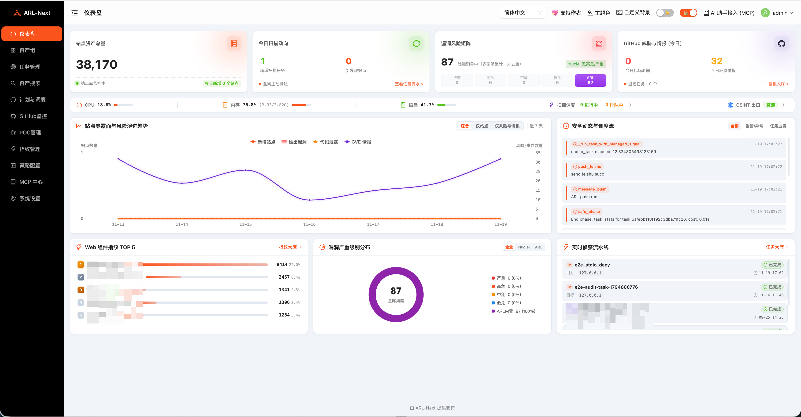
  </p>

<details>
<summary><b>🖼️ 点击展开查看更多核心业务界面（资产组与画像 · 任务调度 · 威胁情报 · MCP 中心 · 系统设置，共 9 张）</b></summary>

<br/>

* **多级资产组与全景资产画像**：统一管理集团多级组织架构，联动企业生态资产关联分析 (OSINT)、网络暴露面测绘 (ASM) 与 12 维资产画像抽屉下钻。

  <p align="center">
    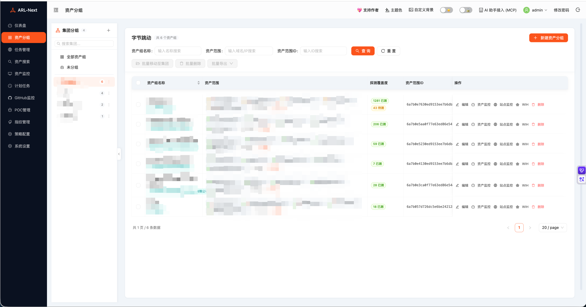
  </p>

  <p align="center">
    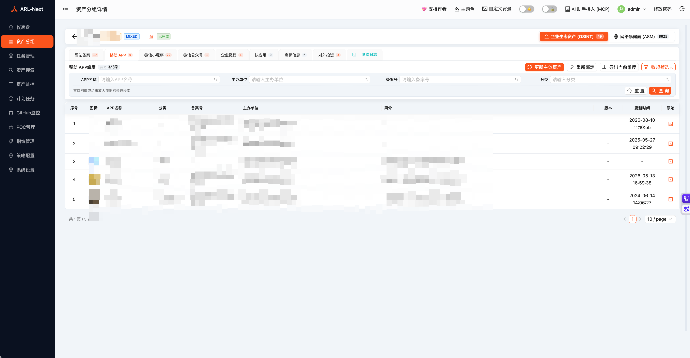
  </p>

  <p align="center">
    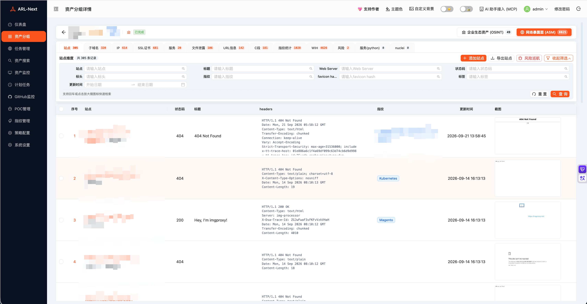
  </p>

  <p align="center">
    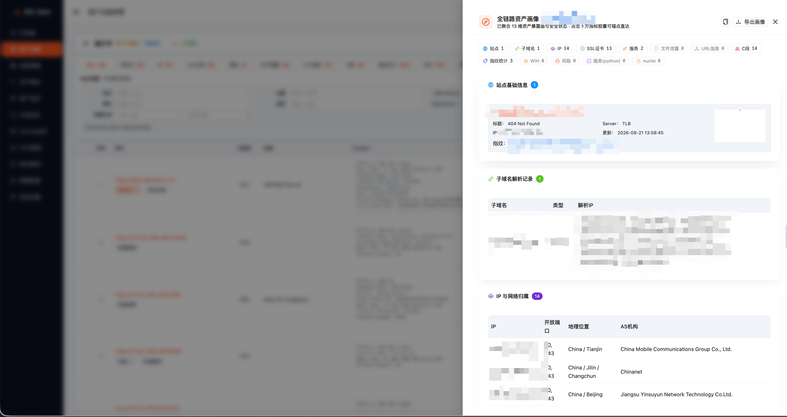
  </p>

* **任务下发与全生命周期管理**：提供快捷预设（快速侦查 / 常规探测 / 深度全量）与自定义策略选择，联动 Nuclei、Python 插件池与 8,800+ Web 指纹库，全程追踪任务状态与增量同步结果。

  <p align="center">
    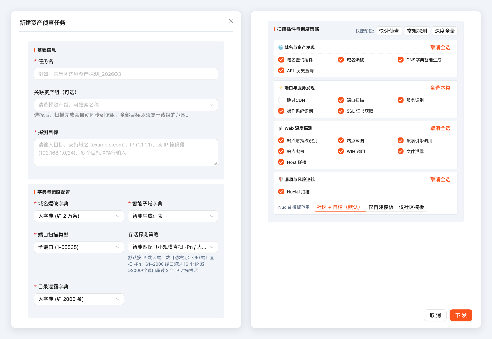
  </p>

  <p align="center">
    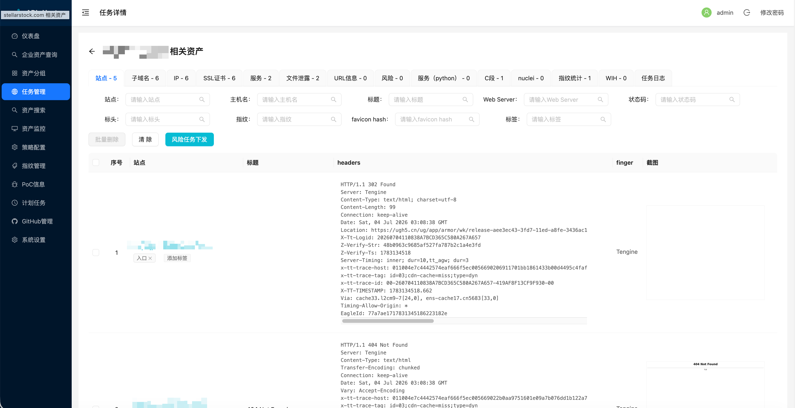
  </p>

* **威胁情报与代码泄露雷达**：追踪最新 CVE 漏洞情报，自动化监听并研判 GitHub 关联代码与凭据泄露。

  <p align="center">
    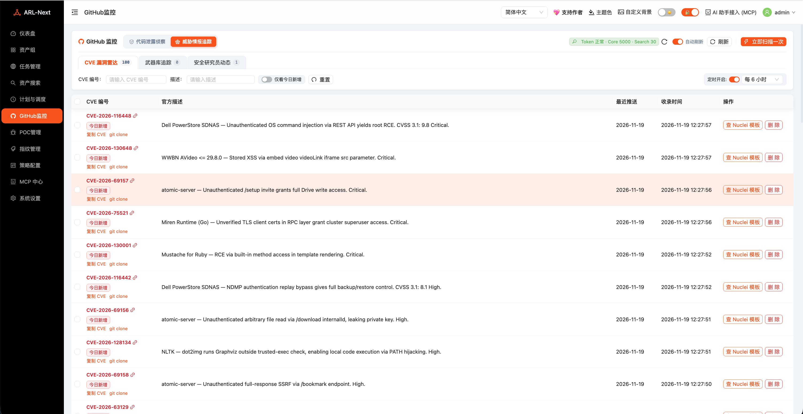
  </p>

* **MCP 服务治理中心**：可视化管理 AI Agent 接入配置与安全策略，支持签发细粒度 Scope 专用密钥、配置单工具开关、速率与条数配额及查看调用审计流水。

  <p align="center">
    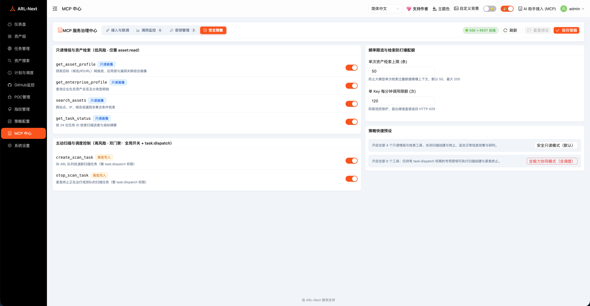
  </p>

* **系统设置与字典武器库**：按情报凭据、代理与红线、扫描与武器库、告警与回调、系统运维五域分区并支持 `/` 快捷检索；内置三栏式字典武器库（跨分类检索、分级预览、导出与在线维护）、并发扩缩容及告警回调通道配置。

  <p align="center">
    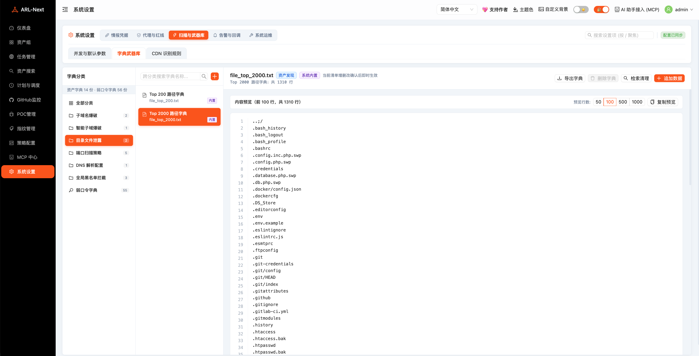
  </p>

</details>

---

## <span id="quick-deploy"></span>🚀 快速部署与访问

**环境要求**：Linux 服务器（Ubuntu / Debian / CentOS / RHEL / 统信等，需 root 权限），推荐 **4 核 4G 及以上**，并放行 **5173** TCP 端口。  
**部署说明**：提供预构建阿里云国内镜像源，`start-prod.sh` 内置环境探测，会自动配置 Swap、补齐 Docker / Compose 并执行就绪探活检查。

> [!TIP]
> 首次上手建议配合 [**🚀 5 分钟快速入门指南 (QUICKSTART.md)**](./docs/QUICKSTART.md)，按步骤走通「部署登录 → 建组 → 下发首个任务 → 查看结果」最小闭环。

### 部署方式

#### 方式一：国内镜像快速部署（推荐）

绝大多数场景在服务器终端直接执行下方命令即可完成拉取与启动：

```bash
mkdir -p ~/ARL-Next && cd ~/ARL-Next && \
docker pull crpi-laul1izptqrf0tkf.cn-beijing.personal.cr.aliyuncs.com/owl234-arl-prod/arl-web:latest && \
docker rm -f arl-temp 2>/dev/null || true && \
docker create --name arl-temp crpi-laul1izptqrf0tkf.cn-beijing.personal.cr.aliyuncs.com/owl234-arl-prod/arl-web:latest && \
docker cp arl-temp:/code/start-prod.sh ./ && \
docker cp arl-temp:/code/docker-compose.prod.yml ./ && \
docker cp arl-temp:/code/updater ./ && \
docker cp arl-temp:/code/tools ./ && \
docker cp arl-temp:/code/version.txt ./ && \
docker cp arl-temp:/code/CHANGELOG.md ./ && \
docker cp arl-temp:/code/CHANGELOG_en.md ./ && \
mkdir -p ./frontend && docker cp arl-temp:/code/frontend/default.conf.prod ./frontend/ && \
docker rm -f arl-temp && \
chmod +x start-prod.sh && bash start-prod.sh
```

> [!TIP]
> - **网页终端粘贴提示**：部分云厂商 Web SSH、VNC 或堡垒机多行粘贴时可能吞掉换行导致报错（如 `No such container: arl-temp`），请展开下方「单行逐步执行版」逐行执行。
> - **裸机未装 Docker**：请先展开下方「方式二」执行第一步补齐基础工具，再回到此处运行。

<details>
<summary><b>🛠️ 若多行粘贴报错，点击展开【单行逐步执行版】</b></summary>
<br/>

在终端中逐行复制执行（无反斜杠连缀）：

```bash
# 1. 创建并进入工作目录
mkdir -p ~/ARL-Next && cd ~/ARL-Next

# 2. 拉取最新生产镜像
docker pull crpi-laul1izptqrf0tkf.cn-beijing.personal.cr.aliyuncs.com/owl234-arl-prod/arl-web:latest

# 3. 创建临时容器提取编排与配置脚本
docker rm -f arl-temp 2>/dev/null || true
docker create --name arl-temp crpi-laul1izptqrf0tkf.cn-beijing.personal.cr.aliyuncs.com/owl234-arl-prod/arl-web:latest
docker cp arl-temp:/code/start-prod.sh ./
docker cp arl-temp:/code/docker-compose.prod.yml ./
docker cp arl-temp:/code/updater ./
docker cp arl-temp:/code/tools ./
docker cp arl-temp:/code/version.txt ./
docker cp arl-temp:/code/CHANGELOG.md ./
docker cp arl-temp:/code/CHANGELOG_en.md ./
mkdir -p ./frontend && docker cp arl-temp:/code/frontend/default.conf.prod ./frontend/
docker rm -f arl-temp

# 4. 赋予执行权限并启动服务
chmod +x start-prod.sh && bash start-prod.sh
```

</details>

<details>
<summary><b>方式二：裸机分步安装基础工具后部署（按系统类型）</b></summary>
<br/>

**第一步：安装基础工具（按系统二选一）**

- Ubuntu / Debian / 统信：
  ```bash
  apt-get update && apt-get install -y docker.io openssl curl && \
  (systemctl enable --now docker 2>/dev/null || service docker start 2>/dev/null || true)
  ```
- CentOS / RHEL / Alibaba Cloud Linux / TencentOS：
  ```bash
  yum install -y openssl curl && \
  (command -v docker &>/dev/null || curl -fsSL https://get.docker.com | bash -s docker --mirror Aliyun) && \
  systemctl enable --now docker 2>/dev/null || true
  ```

**第二步：拉取部署编排并启动（所有系统一致）**

```bash
mkdir -p ~/ARL-Next && cd ~/ARL-Next && \
docker pull crpi-laul1izptqrf0tkf.cn-beijing.personal.cr.aliyuncs.com/owl234-arl-prod/arl-web:latest && \
docker rm -f arl-temp 2>/dev/null || true && \
docker create --name arl-temp crpi-laul1izptqrf0tkf.cn-beijing.personal.cr.aliyuncs.com/owl234-arl-prod/arl-web:latest && \
docker cp arl-temp:/code/start-prod.sh ./ && \
docker cp arl-temp:/code/docker-compose.prod.yml ./ && \
docker cp arl-temp:/code/updater ./ && \
docker cp arl-temp:/code/tools ./ && \
docker cp arl-temp:/code/version.txt ./ && \
docker cp arl-temp:/code/CHANGELOG.md ./ && \
docker cp arl-temp:/code/CHANGELOG_en.md ./ && \
mkdir -p ./frontend && docker cp arl-temp:/code/frontend/default.conf.prod ./frontend/ && \
docker rm -f arl-temp && \
chmod +x start-prod.sh && bash start-prod.sh
```

</details>

<details>
<summary><b>方式三：GitHub 源码克隆部署（需要保留仓库 / 二次开发）</b></summary>
<br/>

```bash
git clone --depth 1 https://github.com/owl234/ARL-Next.git && cd ARL-Next
chmod +x start-prod.sh
bash start-prod.sh
```

> [!TIP]
> `start-prod.sh` 内置环境探针，裸机运行亦会自动安装 Docker 并优化内核配置；启动时默认仍拉取预构建生产镜像（而非在宿主机本地编译）。

</details>

### 🔑 访问与初始凭据

部署完成后，在浏览器中访问：`https://<你的服务器IP>:5173`（首次访问自签名证书按浏览器提示继续前往即可）。

| 验证层级 | 默认账号 | 默认密码 | 说明 |
| :--- | :--- | :--- | :--- |
| **第一层：Nginx Basic Auth 网关** | `admin` | `arl_next` | 前置防扫描器爆破（**默认关闭**，登录后可在顶部导航栏安全开关处开启或关闭；修改密码需先关闭再重新开启） |
| **第二层：ARL-Next 系统登录** | `admin` | 首次启动随机生成 | 既有账号密码保持不变；新密码要求至少 12 个字符 |

在受信宿主机执行以下命令读取首次生成的管理员初始密码（文件权限为 `0600`，密码不会打印到启动日志）：

```bash
docker exec arl-web-prod cat /tmp/arl_initial_admin_password
```

也可在首次启动前通过环境变量 `ARL_ADMIN_PASSWORD` 预设至少 12 个字符的密码（注意 `sudo` 默认会清空环境变量，请使用 `sudo ARL_ADMIN_PASSWORD=... bash start-prod.sh`、`sudo -E bash start-prod.sh`，或在部署目录 `.env` 文件中写入 `ARL_ADMIN_PASSWORD=...`）。修改密码并确认登录成功后，建议删除容器内的初始密码文件（`docker exec arl-web-prod rm -f /tmp/arl_initial_admin_password`）。若未读取而容器已被重建，可按下方常见问题 Q2 执行 `--reset` 重新生成；升级不会重置已有账号。

登录会话有效期为 24 小时。长期 API 或 MCP 集成请使用独立的 `API_KEY` / MCP 专用密钥，详见 [身份鉴权与安全机制](docs/API_GUIDE.md#2-身份鉴权与安全机制)。

> [!IMPORTANT]
> **端口放行**：请确保云服务器控制台安全组及宿主机防火墙均已放行 **5173** TCP 端口：
> ```bash
> # Ubuntu / Debian
> ufw allow 5173/tcp
> # CentOS / RHEL
> firewall-cmd --permanent --add-port=5173/tcp && firewall-cmd --reload
> ```

> [!TIP]
> **可选配置**（不影响基本可用性）：
> - **替换商业证书**：将证书文件重命名为 `arl.crt` 和 `arl.key` 放入 `ssl-certs/` 目录，再次执行 `bash start-prod.sh` 即可切换。
> - **开启 Basic Auth 前置防护**：登录控制台后在顶部导航栏安全开关处开启。

---

## <span id="integration"></span>🤖 AI Agent (MCP) 与 API 集成

ARL-Next 同时面向 **AI Agent 协同** 与 **传统自动化编排** 开放标准化接入能力：

* **🤖 AI Agent 接入（MCP 2.0）**：登录控制台进入左侧菜单 **「MCP 中心」**，可按需签发最小权限密钥并直接复制/导出客户端配置（支持远程 SSE `/mcp/sse` 与本地 Stdio 桥接）。内置 6 项标准工具，其中 4 项只读情报工具默认开放（`get_asset_profile`、`get_enterprise_profile`、`search_assets`、`get_task_status`），2 项扫描调度工具默认关闭并受 Scope 控制（`create_scan_task`、`stop_scan_task`）。
  * 📘 配置说明：[MCP 配置手册 (`mcp-server/README.md`)](./mcp-server/README.md)
  * 🎯 实战提示词：[MCP 渗透测试实战用例库 (`docs/MCP_PENTEST_TEST_CASES.md`)](./docs/MCP_PENTEST_TEST_CASES.md)
* **🔌 RESTful API 与自动化对接**：适用于自动化脚本、CI/CD 流水线与安全编排 (SOAR) 系统集成。
  * 📖 在线交互文档：部署完成后访问 `https://<你的服务器IP>:5173/api/doc` 查看 OpenAPI / Swagger 规范并在线调试。
  * 📘 调用规范与约束：鉴权方式、状态流转与接口约定请参阅 [**API 调用与二次开发约定指南 (`docs/API_GUIDE.md`)**](./docs/API_GUIDE.md)。

---

## 🛠️ 升级、备份与常见问题

### 🔄 生产环境版本升级

#### 方案一：Web 控制台在线更新（推荐）

登录 ARL-Next ➔ 进入 **「系统设置」** ➔ **「系统运维」** ➔ **「版本与系统更新」** ➔ 点击 **「一键系统更新」**。<br/>
宿主机更新守护进程会自动拉取最新镜像、同步编排脚本与版本文件，并在后台完成容器重启与就绪检查，通常无需登录终端。

> [!WARNING]
> 更新过程会重启后台 Worker 容器，**正在运行的扫描任务将被中断**（重启后标记为「异常失败」）。建议在任务空闲时段执行。

<details>
<summary><b>方案二：终端标准手动升级</b></summary>
<br/>

在服务器终端进入部署目录，按初次部署方式执行对应命令：

- **国内镜像部署用户（方式一 / 方式二）**：
  ```bash
  cd ~/ARL-Next && \
  docker pull crpi-laul1izptqrf0tkf.cn-beijing.personal.cr.aliyuncs.com/owl234-arl-prod/arl-web:latest && \
  docker run --rm -v $(pwd):/host crpi-laul1izptqrf0tkf.cn-beijing.personal.cr.aliyuncs.com/owl234-arl-prod/arl-web:latest bash -c "cp /code/start-prod.sh /host/start-prod.sh && cp /code/docker-compose.prod.yml /host/docker-compose.prod.yml && mkdir -p /host/updater && cp -r /code/updater/. /host/updater/ 2>/dev/null || true; mkdir -p /host/tools && cp -r /code/tools/. /host/tools/ 2>/dev/null || true; mkdir -p /host/frontend && cp /code/frontend/default.conf.prod /host/frontend/default.conf.prod 2>/dev/null || true; cp /code/version.txt /host/version.txt 2>/dev/null || true; cp /code/CHANGELOG.md /host/CHANGELOG.md 2>/dev/null || true; cp /code/CHANGELOG_en.md /host/CHANGELOG_en.md 2>/dev/null || true" && \
  sudo bash start-prod.sh
  ```

- **Git 源码部署用户（方式三）**：
  ```bash
  cd ~/ARL-Next && git pull && sudo bash start-prod.sh
  ```

</details>

> [!TIP]
> **升级保障**：升级流程内置数据库增量迁移与索引维护逻辑；拉取新镜像前会为当前运行镜像打上 `backup-stable` 回滚标签，并在容器启动后通过就绪探针验证 API 可用性。

---

### 💾 系统数据备份与迁移恢复

支持在跨机迁移或重大升级前，对全库 MongoDB 集合、站点截图（可选排除）、自定义字典与 PoC 插件进行打包归档（内置 SHA256 完整性校验）与 `--drop` 全量覆盖恢复：

- **Web 控制台操作**：进入 **「系统设置」 ➔ 「系统运维」 ➔ 「数据备份与恢复」**，可在线创建备份、下载或上传外部归档包，并通过二次输入 `RESTORE` 确认执行覆盖恢复。
- **终端 CLI 工具**（宿主机执行会自动透传至容器）：
  ```bash
  # 创建全量备份（追加 --no-screenshots 可排除截图以减小归档体积）
  python3 tools/arl_backup.py backup --note "升级前全量快照"

  # 列出已有备份包或查看归档元数据
  python3 tools/arl_backup.py list
  python3 tools/arl_backup.py info <archive_name.tar.gz>

  # 覆盖恢复指定备份包
  python3 tools/arl_backup.py restore <archive_name.tar.gz>
  ```

---

### ❓ 常见问题与排错 (FAQ)

<details>
<summary><b>Q1: 首次通过 HTTPS 访问时，浏览器提示“不安全 / 您的连接不是私密连接”？</b></summary>
<br/>

**A:** 系统首次启动会自动签发本地自签名 SSL 证书。
- 点击浏览器页面 **“高级” ➔ “继续前往 (不安全)”** 即可访问（Chromium 系浏览器亦可在警告页直接键盘输入 `thisisunsafe` 跳过）。
- **替换正式证书**：将商业证书重命名为 `arl.crt` 和 `arl.key` 放至 `ssl-certs/` 目录，重新执行 `bash start-prod.sh` 生效。
</details>

<details>
<summary><b>Q2: 忘记系统登录密码或 Basic Auth 网关凭证怎么办？</b></summary>
<br/>

**A:** 在受信宿主机终端执行对应重置操作：
- **重置平台管理员密码 (`admin`)**：
  ```bash
  docker exec -it arl-web-prod /code/backend/.venv-docker/bin/python3 /code/backend/inject_user.py --reset
  ```
  > [!NOTE]
  > 正常启动会保留既有密码；追加 `--reset` 会生成新的随机密码并撤销已有会话。新密码从容器内 `/tmp/arl_initial_admin_password` 读取；若设置了 `ARL_ADMIN_PASSWORD` 则使用该值。
- **重置/查看 Basic Auth 凭据**：编辑工作目录下的 `frontend/.htpasswd`，或登录后在顶部导航栏安全开关处关闭并重新开启以重新设定。
</details>

<details>
<summary><b>Q3: 点击 Web 端“一键系统更新”时提示 <code>[ERROR]触发更新失败</code>？</b></summary>
<br/>

**A:** 通常因宿主机更新守护进程未响应导致，可通过以下任一方式处理：
- **方案 A（推荐）**：直接在终端执行手动升级：
  ```bash
  cd ~/ARL-Next && sudo bash start-prod.sh
  ```
- **方案 B**：重启宿主机更新守护进程后回到 Web 端重试：
  ```bash
  sudo systemctl restart arl-updater.service
  ```
</details>

<details>
<summary><b>Q4: 扫描任务较多时，如何调整系统并发性能？</b></summary>
<br/>

**A:** ARL-Next 支持并发参数动态热调，无需重启容器：
- 登录控制台 ➔ 进入 **「系统设置」** ➔ **「扫描与武器库」** ➔ **「并发与默认参数」**；
- 可视化调整**重任务队列并发**（常规域名 / IP 扫描、风险巡航、Nuclei / PoC 长线任务）、**轻任务队列并发**（空间测绘 / 单点更新 / WIH 提取 / 数据同步）与 **OSINT 任务并发**；
- 上述三项均为 **Worker 进程数**（通常 `1~128`），受宿主机内存限制，页面会基于当前内存给出推荐值并支持回填；
- ⚠️ 如需调整**单个任务内部**的 DNS 爆破发包并发度（通常在数百至上千量级），请在同一子页下方的 **「单任务内发包并发与默认扫描参数」** 区域设置。二者属于不同量级指标，请勿混填。
</details>

<details>
<summary><b>Q5: 常用 Docker 容器维护与日志排查命令速查？</b></summary>
<br/>

```bash
# 查看所有容器运行状态与健康探针
docker compose -f docker-compose.prod.yml ps

# 实时查看扫描 Worker 执行日志
docker compose -f docker-compose.prod.yml logs -f arl-worker

# 平滑重启核心容器服务
docker compose -f docker-compose.prod.yml restart
```
</details>

<details>
<summary><b>Q6: 在 CentOS 7 或 Linux 3.x 等老旧内核环境下部署，前端容器报错或端口无法访问？</b></summary>
<br/>

**A:** 在 Linux 3.10 等老旧内核上，Docker 默认 Seccomp 策略可能拦截部分系统调用（如 `SYS_pwritev2`），导致前端 Nginx 写入 PID 文件失败（`pwrite() "/run/nginx.pid" failed (1: Operation not permitted)`）并反复重启。

**排查与处置**：
1. **确认编排配置**：最新版 `docker-compose.prod.yml` 已默认为 `arl-frontend` 配置 `security_opt: [seccomp:unconfined]`。
2. **存量环境快速修复**：若早期编排缺少该项，可在部署目录执行以下命令补齐并重建前端容器（幂等操作）：
   ```bash
   grep -q "seccomp:unconfined" docker-compose.prod.yml || sed -i '/container_name: arl-frontend-prod/a \    security_opt:\n      - seccomp:unconfined' docker-compose.prod.yml
   docker compose -f docker-compose.prod.yml up -d arl-frontend
   ```
3. **验证就绪**：执行 `bash start-prod.sh`，等待内置健康断言与端口探针校验通过。
</details>

---

## <span id="architecture"></span>🏗️ 系统架构

ARL-Next 采用前后端分离、多队列异步任务调度与轻量微服务隔离架构，所有外部流量均经由 Nginx HTTPS 网关统一接入，内部组件在私有 Docker 网络中隔离运行：

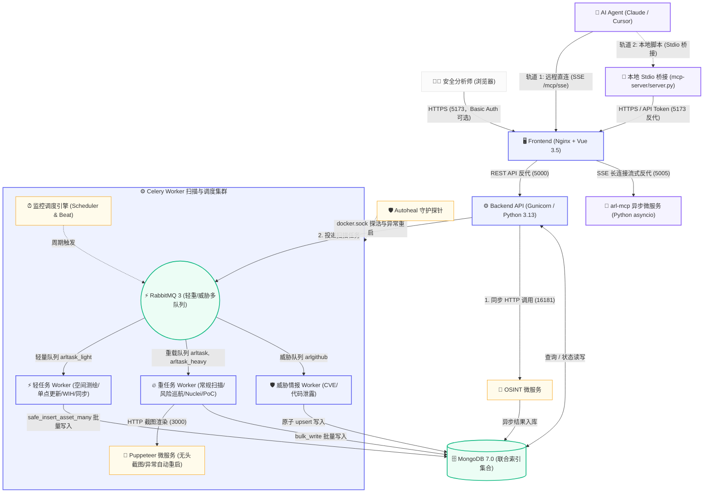

### 架构要点

1. 🖥️ **统一网关与交互层 (`Frontend / Nginx`)**：基于 **Vue 3.5 + Nginx**，对外仅暴露 `5173` HTTPS 入口，提供可选 **Basic Auth 前置防护**、流式无缓冲反代（服务于 MCP SSE 与大文件备份传输）及三语国际化交互界面。
2. ⚙️ **业务接口与独立异步 MCP 容器 (`Backend / arl-mcp`)**：核心 API 基于 **Python 3.13 + Gunicorn**；SSE 长连接拆分至独立的 **`arl-mcp` (`asyncio`) 容器**承载，与主业务线程池物理隔离，降低长连接对控制台吞吐的影响。
3. 🧩 **独立企业测绘服务 (`OSINT Service`)**：专职天眼查与工信部多源企业资产采集，由 Backend 经 HTTP 调用（含 5s 超时保护），与扫描队列隔离以避免长耗时测绘阻塞常规扫描。
4. ⚡ **多队列 Worker 与内存控制 (`Celery Cluster`)**：按**轻量 / 重载 / 威胁情报**分队列消费，配合子进程生命周期回收与并发租约控制缓解内存增长与发包争抢；端口扫描引擎统一基于 **Nmap 7.95 稳定版**。
5. 🛡️ **无头截图隔离与守护探针 (`Puppeteer / Autoheal`)**：站点截图由常驻无头浏览器微服务隔离渲染并支持请求计数轮转；**Autoheal** 定期检测 Worker 健康状态，在节点无响应时自动拉起恢复。
6. 🗄️ **批量持久化存储 (`MongoDB 7.0`)**：高频资产写入通过 `safe_insert_asset_many` / `bulk_write` 批量接口完成，核心集合维护联合唯一索引并配置 WiredTiger 1GB 缓存池上限，兼顾高吞吐写入与资源平稳性。

---

## 📜 更新日志

详细的版本迭代记录、新特性说明与问题修复历史，请参阅 ➔ [**CHANGELOG.md**](./CHANGELOG.md)

---

## 🤝 致谢

本项目的发展离不开开源社区的启发与贡献，特此致谢：

* **开源溯源**：早期架构脱胎并演进自开源项目 [ARL (资产侦察灯塔)](https://github.com/TophantTechnology/ARL)，并参考了 [Aabyss-Team/ARL](https://github.com/Aabyss-Team/ARL) 与 [adysec/ARL](https://github.com/adysec/ARL) 等社区实践。
* **指纹数据**：特别鸣谢 **威零安全团队** (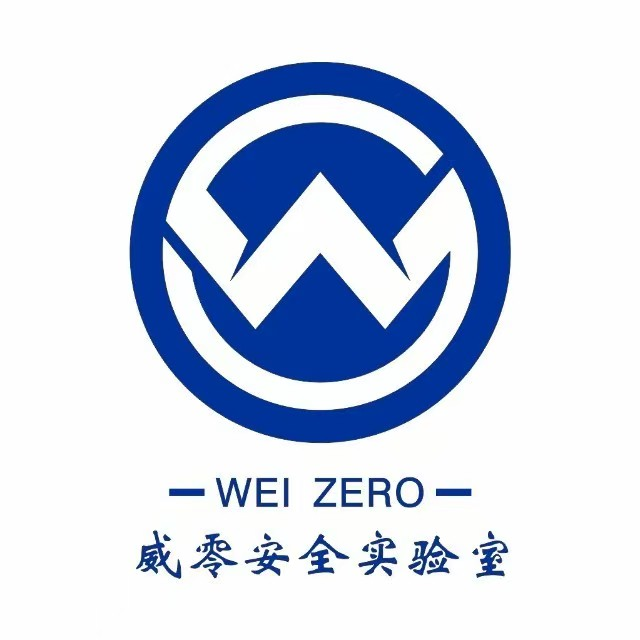 公众号) 提供的高质量 Web 指纹库支撑。
* **模块参考**：企业测绘与威胁监控模块参考了 [ICP_Query](https://github.com/HG-ha/ICP_Query) 与 [github-cve-monitor](https://github.com/yhy0/github-cve-monitor) 的设计思路。

---

## 💖 赞助与支持

ARL-Next 的持续维护与迭代离不开社区伙伴的支持，特别致谢以下赞助者：

<p align="center">
  
</p>

<p align="center">
  <a href="https://github.com/robotfish001" target="_blank">
    
  </a>
  <a href="https://github.com/phpmac" target="_blank">
    
  </a>
  <a href="https://github.com/123lpone" target="_blank">
    
  </a>
  <a href="https://github.com/Qexzi" target="_blank">
    
  </a>
  <a style="cursor: default;">
    
  </a>
</p>

---

## ⚠️ 法律与免责声明

> [!CAUTION]
> **合规红线与免责条款**：  
> 本平台仅供经过合法授权的企业安全建设、SRC 漏洞挖掘、学术攻防演练及安全研究使用。使用本工具开展任何探测与扫描前，使用者必须确保已获得目标资产所有者的明确书面授权，并严格遵守《中华人民共和国网络安全法》及当地法律法规。  
> **严禁利用本工具从事任何未授权的入侵、攻击或破坏行为！** 任何因违规滥用导致的网络安全事故或法律责任，均由使用者本人独立承担，本项目作者与贡献者不承担任何直接或连带责任。

---

## 📄 开源协议 (License)

ARL-Next 项目遵循 [GNU General Public License v3.0 (GPL-3.0)](./LICENSE) 开源许可证协议。

* 🆓 **自由与开源**：您可以免费用于企业自建、安全研究、资产测绘与攻防演练，并享有自由阅读、修改与定制源码的权利。
* 🌐 **同协议共享**：若您在二次开发中修改或基于本项目构建衍生作品并向第三方分发，必须保持在相同的 GPL-3.0 许可证下完整开源相关代码。
* ⚖️ **署名与免责保留**：任何形式的源码复制与再分发，均须保留原始作者版权声明、许可证全文以及免责条款。

---

## 💬 交流群与反馈通道

- 🐛 **Bug 提交与功能建议**：欢迎通过 [GitHub Issues](https://github.com/owl234/ARL-Next/issues) 提交反馈，持续跟进处理。
- 💡 **技术交流与群聊**：欢迎在 [GitHub Discussions](https://github.com/owl234/ARL-Next/discussions) 参与讨论，或扫码添加作者微信、加入 QQ 交流群，交流资产测绘、红蓝对抗与 AI 自动化安全实践。
- 📢 **版本发布动态**：欢迎关注微信公众号【**owl安全**】，获取版本迭代说明、架构解析与更新通知。

<table align="center">
  <tr>
    <td align="center" style="padding: 10px 25px;"><b>👤 个人微信</b></td>
    <td align="center" style="padding: 10px 25px;"><b>📢 微信公众号 (owl安全)</b></td>
    <td align="center" style="padding: 10px 25px;"><b>🐧 QQ 技术交流群</b></td>
  </tr>
  <tr>
    <td align="center" style="padding: 10px 25px;"></td>
    <td align="center" style="padding: 10px 25px;"></td>
    <td align="center" style="padding: 10px 25px;">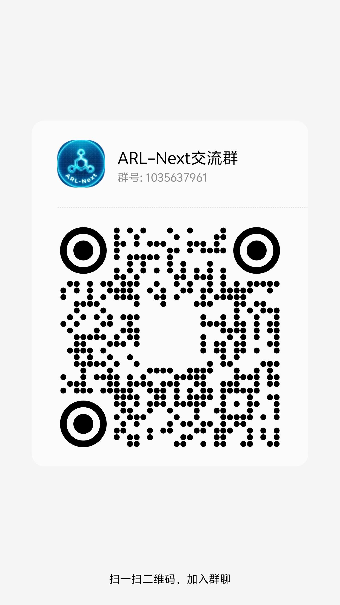</td>
  </tr>
</table>

---

## 🌟 Star History

<div align="center">

<a href="https://www.star-history.com/?repos=owl234%2Farl-next&type=date&legend=top-left">
 <picture>
   <source media="(prefers-color-scheme: dark)" srcset="https://api.star-history.com/chart?repos=owl234/arl-next&type=date&theme=dark&legend=top-left&sealed_token=vNF3XBBUYjnOkZ1XfTODaJEURB73qlNr1zXyCH6HOUbJGKju3QmIb7pVDyjCK67Ra-ukzG7dgZ3B3HDpCKJ3raveN9bOCec7r6gDILhjGrYbcVEV2Gy5Ew" />
   <source media="(prefers-color-scheme: light)" srcset="https://api.star-history.com/chart?repos=owl234/arl-next&type=date&legend=top-left&sealed_token=vNF3XBBUYjnOkZ1XfTODaJEURB73qlNr1zXyCH6HOUbJGKju3QmIb7pVDyjCK67Ra-ukzG7dgZ3B3HDpCKJ3raveN9bOCec7r6gDILhjGrYbcVEV2Gy5Ew" />
   
 </picture>
</a>

</div>
