<div align="center">

  <p>
    <b>English</b> |
    <a href="./README.md"><b>简体中文</b></a>
  </p>

  # ARL-Next
  **Modern Attack Surface Reconnaissance & Vulnerability Monitoring Platform**

  <p><b>Enterprise Asset Mapping · Attack Surface & Vulnerability Discovery · Continuous Threat Monitoring · Native AI (MCP) Integration</b></p>

  <p>
    <a href="https://github.com/owl234/ARL-Next/releases"></a>
    <a href="https://github.com/owl234/ARL-Next/stargazers"></a>
    <a href="https://github.com/owl234/ARL-Next/network/members"></a>
    <a href="./LICENSE"></a>
  </p>

  <p>
    
    
    
    
    
    
  </p>

  <p>
    <a href="./docs/QUICKSTART_en.md"><b>🚀 Quickstart (5-Min)</b></a> •
    <a href="#scenarios"><b>🎯 Use Cases</b></a> •
    <a href="#core-features"><b>✨ Capabilities</b></a> •
    <a href="#preview"><b>📸 Preview</b></a> •
    <a href="#quick-deploy"><b>⚡ Deployment</b></a> •
    <a href="#integration"><b>🤖 MCP & API</b></a> •
    <a href="#architecture"><b>🏗️ Architecture</b></a> •
    <a href="./CHANGELOG_en.md"><b>📜 Changelog</b></a> •
    <a href="https://github.com/owl234/ARL-Next/discussions"><b>💬 Discussions</b></a>
  </p>
</div>

<br/>

---

## <span id="scenarios"></span>💡 What is ARL-Next & Who Is It For?

> **ARL-Next** is an open-source, self-hosted **attack surface reconnaissance and vulnerability monitoring platform** built for enterprise security teams, bug bounty / SRC researchers, and authorized penetration testers.  
> It unifies **enterprise asset discovery → attack surface mapping & vulnerability detection → continuous monitoring & alerting → AI Agent (MCP) collaboration** into a single workflow, helping you map, organize, and govern real-world external exposure starting from a company name, domain, or IP range.

### 🎯 Typical Use Cases

| Use Case | Challenge | How ARL-Next Helps |
| :--- | :--- | :--- |
| **Enterprise Attack Surface Inventory & Governance** | Assets across subsidiaries are fragmented; shadow web apps, mobile apps, and mini-programs are hard to track continuously | Correlates websites, mobile apps, mini-programs, and quick apps via corporate OSINT (Tianyancha / MIIT ICP) into hierarchical asset groups with a 12-dimensional asset profile drawer |
| **Authorized Pentesting & Bug Bounty Recon** | Chaining subdomain, port, fingerprint, JS extraction, and vulnerability scanners manually yields scattered outputs | Orchestrates subdomain brute-forcing, adaptive port scanning, 8,800+ Web fingerprints, WIH JS endpoint extraction, and Nuclei / PoC scanning in one workspace with unified search and export |
| **Continuous Exposure & Leak Monitoring** | Newly exposed services, emerging CVEs, and GitHub credential leaks often go unnoticed until exploitation | Combines scheduled scans and incremental asset group monitoring with CVE feeds, a GitHub leak triage workbench, and severity-filtered Nuclei webhook alerts |
| **AI Agent-Assisted Security Analysis** | Analysts spend repetitive time pivoting across pages to assemble exposure summaries for a host or organization | Connects Cursor, Claude Desktop, and other MCP clients through the built-in **MCP Center** for natural-language asset profiling, enterprise lookups, and scoped scan dispatch |

---

## <span id="core-features"></span>✨ End-to-End Capabilities

### 1. Enterprise Asset Mapping & Hierarchical Asset Groups
* **Flexible Group Creation**: Create asset groups immediately by entering IPs, CIDRs, and domains manually, or run multi-source corporate reconnaissance (Tianyancha & MIIT ICP) covering **websites, mobile apps, mini-programs, and quick apps** with automatic group creation, batch stop, checkpoint resume, and in-place detail backfill.
* **Multi-Tier Groups & Panoramic Profiling**: Manage multi-tier corporate hierarchies (including group dissolution and transfer); drill down via the **12-dimensional asset profile drawer** inside Asset Group details, or query across tasks in **Asset search** across the same **12 asset tab dimensions** (including Nuclei results, with port services and Python plugin services unified under Services).

### 2. Attack Surface Discovery & Vulnerability Detection
* **Full Reconnaissance Pipeline**: Covers subdomain discovery and dictionary brute-forcing, Nmap 7.95 port scanning (with adaptive host discovery modes), an **8,800+ Web technology fingerprint repository**, and task/policy-level optional headless site screenshots.
* **WIH Sensitive Info & API Discovery**: Built-in pure-Python streaming extractor identifies sensitive data from HTML and same-origin JS, statically extracts relative API endpoint candidates, and performs controlled same-origin GET reachability checks.
* **Nuclei & Python PoC Orchestration**: Integrates Nuclei community and custom multi-protocol templates (`web` / `network` / `dns` bucketing, custom-only policies, and online single-target live dry-run debugging) alongside a Python PoC plugin pool (PoC verification, weak-credential checks, service identification) with reusable scan policies.

### 3. Continuous Monitoring, Threat Intel & Targeted Alerts
* **Scheduled Scans & Asset Monitoring**: Separate management for recurring scan schedules and incremental asset group monitoring under **Plans and schedules** to detect newly exposed domains, sites, and services.
* **CVE Feeds & GitHub Leak Triage**: Continuously tracks CVE vulnerability feeds and monitors GitHub for sensitive code and credential leaks, featuring a triage workbench with status transitions, noisy-repo blocklists, a built-in regex code reader, and CSV export.
* **Webhooks & Dedicated Nuclei Push**: Supports task completion callbacks plus a dedicated Nuclei vulnerability push channel with severity-level filtering.

### 4. Native AI Collaboration & MCP Governance
* **Dual-Mode Client Integration**: Compliant with the Model Context Protocol (2024-11-05) specification, supporting both **Remote SSE direct connection** and **Local Stdio bridge** for Cursor, Claude Desktop, Claude Code, Windsurf, and Antigravity.
* **Visual Access Governance**: Issue least-privilege scoped keys in **MCP Center** (`asset:read` read-only intelligence separated from `task:dispatch` scan control), toggle individual tools, enforce query-size and rate limits, and review call audit logs.

### 5. Multi-Protocol Proxy, Online Operations & Multilingual UI
* **Unified Proxy Pool & 3-Domain Routing**: Manage `HTTP` / `HTTPS` / `SOCKS5` proxy pools with independent egress strategies for `scan`, `osint`, and `intel` traffic, internal CIDR and custom `NO_PROXY` bypass allowlists, and inline health probes.
* **5-Domain Settings & Flexible Operations**: Settings organized across **Intel & APIs / Proxy & Guardrails / Scan & Arsenal / Alerts & Webhooks / System Ops** with `/` quick search; includes scan exclusion guardrails (IP / domain), a 3-pane wordlist arsenal, live tuning of worker-process and per-task packet concurrency, Web console online upgrades, and full backup & migration restore.
* **Multilingual & Modern UX**: Real-time switching across **Simplified Chinese, English, and Russian (`zh-CN` / `en-US` / `ru-RU`)**, dark/light themes, customizable sidebar ordering, sticky table headers and action bars, and local pagination persistence.

---

## <span id="preview"></span>📸 Interface Preview

* **Global Dashboard**: Visualizes attack surface posture, recent reconnaissance activity, vulnerability distribution, and threat feeds alongside host resource telemetry (CPU / memory / disk), task queue status, TOP 5 Web fingerprints, and active pipeline progress.

  <p align="center">
    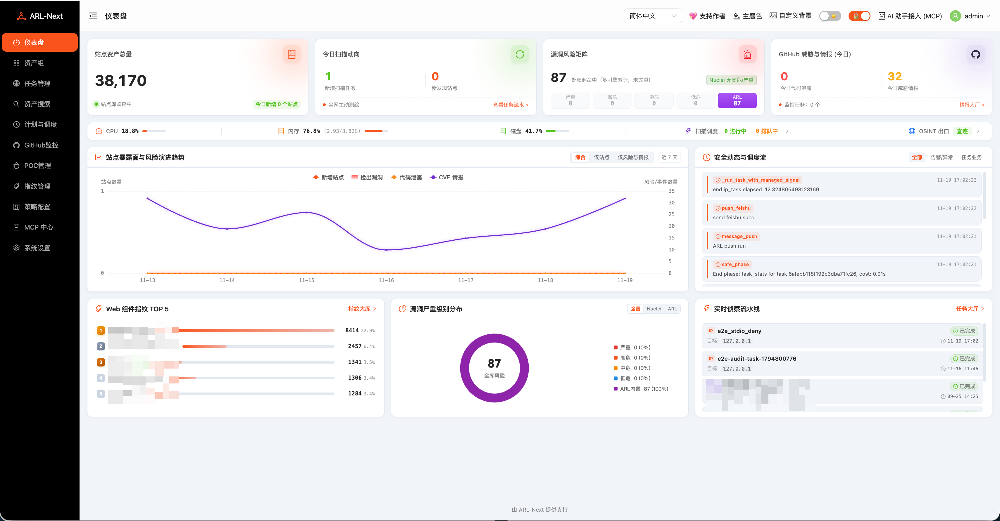
  </p>

<details>
<summary><b>🖼️ Click to expand more core application views (Asset Groups & Profile · Tasks · Threat Intel · MCP Center · System Settings — 9 screenshots)</b></summary>

<br/>

* **Hierarchical Asset Groups & Panoramic Asset Profile**: Manage multi-tier group hierarchies, correlate corporate OSINT assets, map external attack surfaces (ASM), and drill down via the 12-dimensional asset profile drawer.

  <p align="center">
    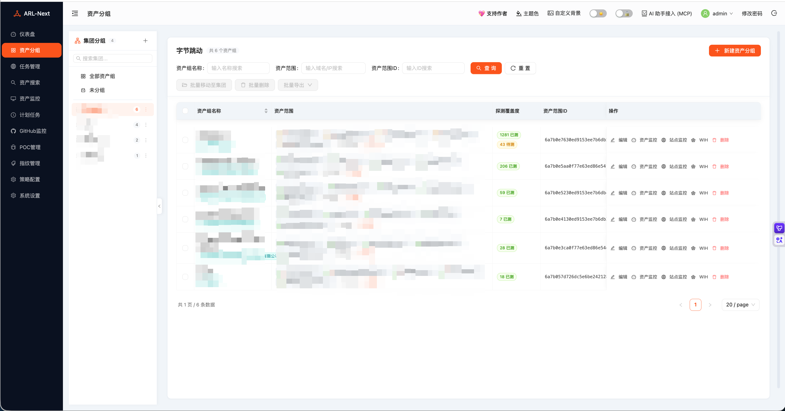
  </p>

  <p align="center">
    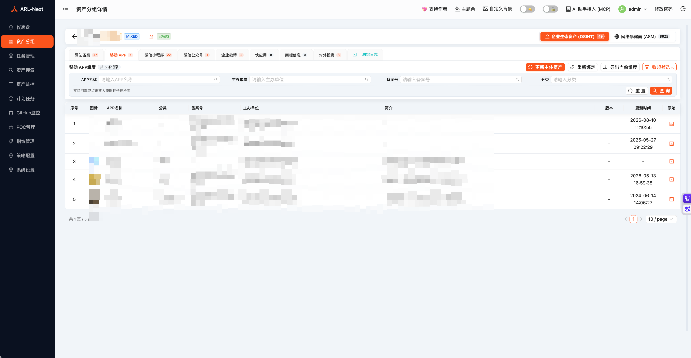
  </p>

  <p align="center">
    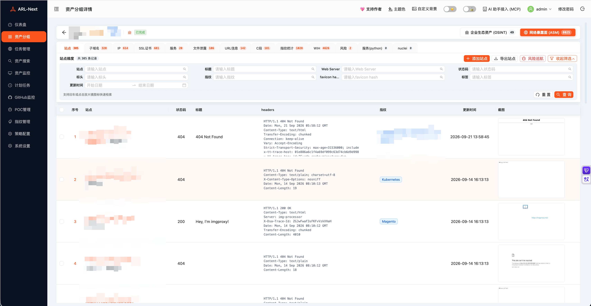
  </p>

  <p align="center">
    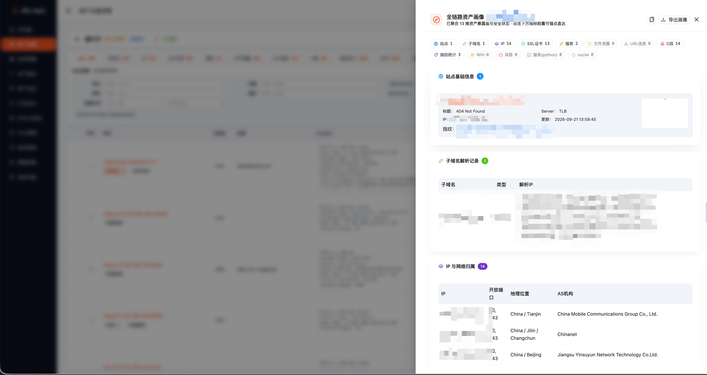
  </p>

* **Task Dispatch & Full Lifecycle Management**: Quick scan presets (Quick discovery / Standard discovery / Full discovery) and custom policies integrated with Nuclei, Python plugins, and 8,800+ Web fingerprints, tracking task stages and incremental group sync summaries.

  <p align="center">
    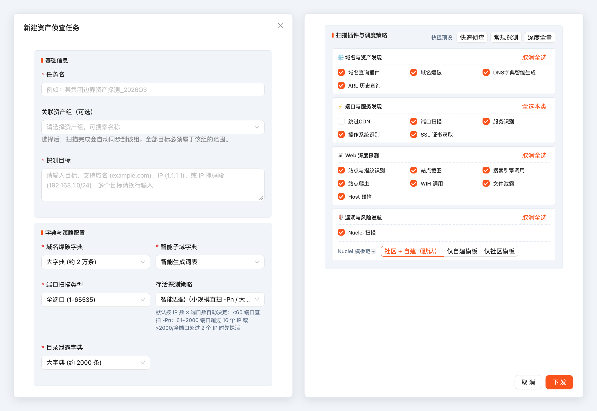
  </p>

  <p align="center">
    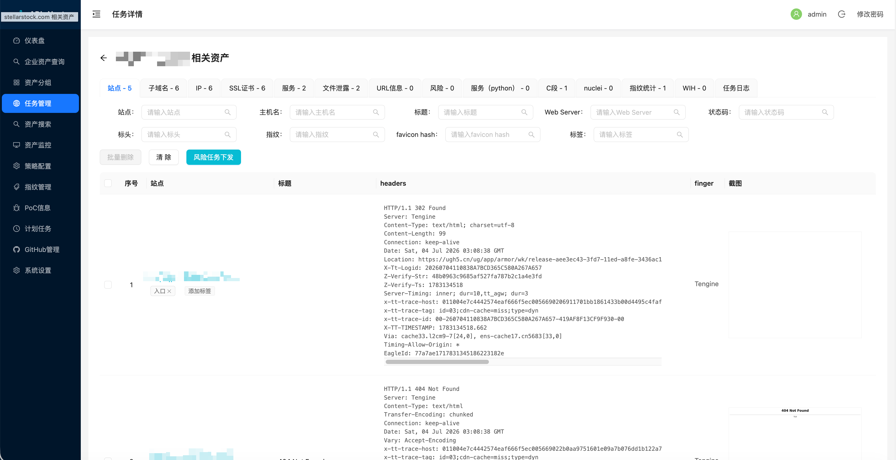
  </p>

* **Threat Intelligence & Credential Leak Radar**: Tracks global CVE feeds and monitors GitHub repositories for sensitive code and credential disclosures.

  <p align="center">
    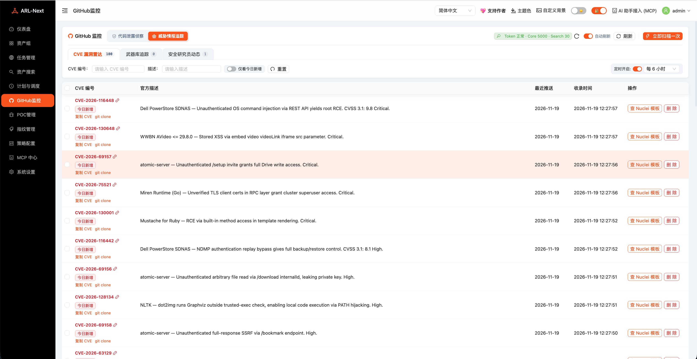
  </p>

* **MCP Service Governance Center**: Visually manages AI Agent connections, scoped API keys, tool-level switches, query and rate quotas, and call audit logs.

  <p align="center">
    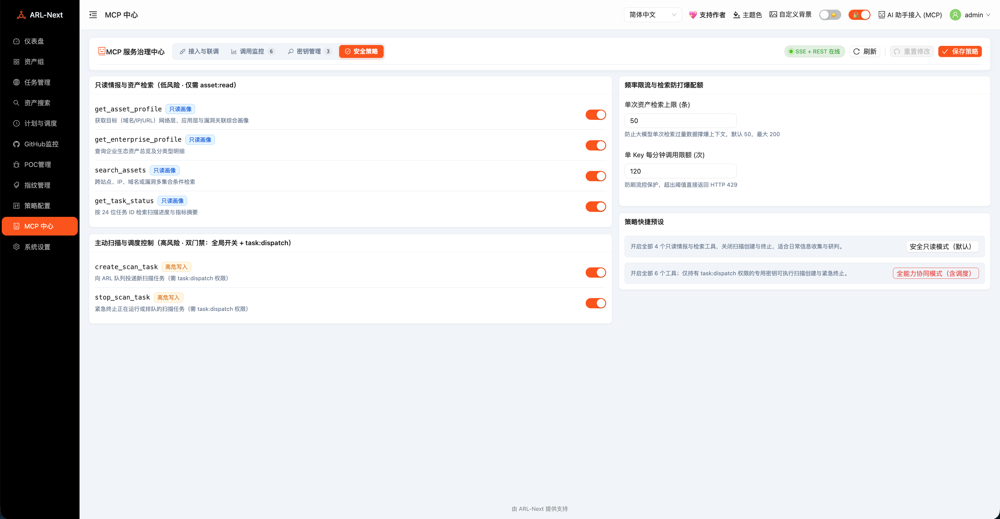
  </p>

* **System Settings & Wordlist Arsenal**: Five workflow domains (Intel & APIs, Proxy & Guardrails, Scan & Arsenal, Alerts & Webhooks, System Ops) with `/` quick search, a 3-pane wordlist workbench (cross-category search, tiered preview, export, inline maintenance), live concurrency tuning, and alert webhook configuration.

  <p align="center">
    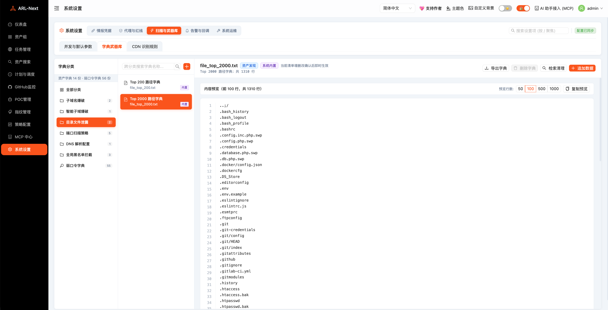
  </p>

</details>

---

## <span id="quick-deploy"></span>🚀 Quick Deployment & Access

**Requirements**: Linux server (Ubuntu / Debian / CentOS / RHEL / UOS, etc. with root privileges), recommended **4-Core CPU, 4GB RAM or higher**, with TCP port **5173** open.  
**Delivery**: Pre-built container images hosted on Alibaba Cloud ACR; `start-prod.sh` automatically configures Swap, installs missing Docker / Compose packages, and runs readiness health probes.

> [!TIP]
> First time deploying? Follow the [**🚀 5-Minute Quickstart Guide (QUICKSTART_en.md)**](./docs/QUICKSTART_en.md) to complete the minimal loop: **Deploy & Sign In → Create Asset Group → Dispatch First Task → Inspect Results**.

### Deployment Methods

#### Method 1: Accelerated Mirror Deployment (Recommended)

Run the command below in your server terminal to pull the orchestration scripts and start the stack:

```bash
mkdir -p ~/ARL-Next && cd ~/ARL-Next && \
docker pull crpi-laul1izptqrf0tkf.cn-beijing.personal.cr.aliyuncs.com/owl234-arl-prod/arl-web:latest && \
docker rm -f arl-temp 2>/dev/null || true && \
docker create --name arl-temp crpi-laul1izptqrf0tkf.cn-beijing.personal.cr.aliyuncs.com/owl234-arl-prod/arl-web:latest && \
docker cp arl-temp:/code/start-prod.sh ./ && \
docker cp arl-temp:/code/docker-compose.prod.yml ./ && \
docker cp arl-temp:/code/updater ./ && \
docker cp arl-temp:/code/tools ./ && \
docker cp arl-temp:/code/version.txt ./ && \
docker cp arl-temp:/code/CHANGELOG.md ./ && \
docker cp arl-temp:/code/CHANGELOG_en.md ./ && \
mkdir -p ./frontend && docker cp arl-temp:/code/frontend/default.conf.prod ./frontend/ && \
docker rm -f arl-temp && \
chmod +x start-prod.sh && bash start-prod.sh
```

> [!TIP]
> - **Web Console Paste Tip**: Some cloud Web SSH, VNC, or bastion consoles drop line continuations on multi-line paste (causing errors like `No such container: arl-temp`). Expand "Step-by-Step Single-Line Commands" below and run one line at a time.
> - **No Docker Yet**: Run Step 1 of "Method 2" below first, then return here.

<details>
<summary><b>🛠️ If multi-line paste errors occur, click to expand [Step-by-Step Single-Line Commands]</b></summary>
<br/>

Run each line independently without backslash continuation:

```bash
# 1. Create and enter directory
mkdir -p ~/ARL-Next && cd ~/ARL-Next

# 2. Pull the latest production image
docker pull crpi-laul1izptqrf0tkf.cn-beijing.personal.cr.aliyuncs.com/owl234-arl-prod/arl-web:latest

# 3. Create temporary container to extract orchestration scripts
docker rm -f arl-temp 2>/dev/null || true
docker create --name arl-temp crpi-laul1izptqrf0tkf.cn-beijing.personal.cr.aliyuncs.com/owl234-arl-prod/arl-web:latest
docker cp arl-temp:/code/start-prod.sh ./
docker cp arl-temp:/code/docker-compose.prod.yml ./
docker cp arl-temp:/code/updater ./
docker cp arl-temp:/code/tools ./
docker cp arl-temp:/code/version.txt ./
docker cp arl-temp:/code/CHANGELOG.md ./
docker cp arl-temp:/code/CHANGELOG_en.md ./
mkdir -p ./frontend && docker cp arl-temp:/code/frontend/default.conf.prod ./frontend/
docker rm -f arl-temp

# 4. Grant execution permissions and start the stack
chmod +x start-prod.sh && bash start-prod.sh
```

</details>

<details>
<summary><b>Method 2: Bare-Metal Step-by-Step Installation (by OS type)</b></summary>
<br/>

**Step 1: Install base tools (choose your OS)**

- Ubuntu / Debian / UOS:
  ```bash
  apt-get update && apt-get install -y docker.io openssl curl && \
  (systemctl enable --now docker 2>/dev/null || service docker start 2>/dev/null || true)
  ```
- CentOS / RHEL / Alibaba Cloud Linux / TencentOS:
  ```bash
  yum install -y openssl curl && \
  (command -v docker &>/dev/null || curl -fsSL https://get.docker.com | bash -s docker --mirror Aliyun) && \
  systemctl enable --now docker 2>/dev/null || true
  ```

**Step 2: Pull orchestration files and start (identical for all systems)**

```bash
mkdir -p ~/ARL-Next && cd ~/ARL-Next && \
docker pull crpi-laul1izptqrf0tkf.cn-beijing.personal.cr.aliyuncs.com/owl234-arl-prod/arl-web:latest && \
docker rm -f arl-temp 2>/dev/null || true && \
docker create --name arl-temp crpi-laul1izptqrf0tkf.cn-beijing.personal.cr.aliyuncs.com/owl234-arl-prod/arl-web:latest && \
docker cp arl-temp:/code/start-prod.sh ./ && \
docker cp arl-temp:/code/docker-compose.prod.yml ./ && \
docker cp arl-temp:/code/updater ./ && \
docker cp arl-temp:/code/tools ./ && \
docker cp arl-temp:/code/version.txt ./ && \
docker cp arl-temp:/code/CHANGELOG.md ./ && \
docker cp arl-temp:/code/CHANGELOG_en.md ./ && \
mkdir -p ./frontend && docker cp arl-temp:/code/frontend/default.conf.prod ./frontend/ && \
docker rm -f arl-temp && \
chmod +x start-prod.sh && bash start-prod.sh
```

</details>

<details>
<summary><b>Method 3: Git Clone Source Deployment (Keep repository / customization)</b></summary>
<br/>

```bash
git clone --depth 1 https://github.com/owl234/ARL-Next.git && cd ARL-Next
chmod +x start-prod.sh
bash start-prod.sh
```

> [!TIP]
> `start-prod.sh` includes environment probes that also install Docker and tune kernel parameters on bare-metal systems; by default it still pulls the pre-built production images rather than compiling locally on the host.

</details>

### 🔑 Access & Initial Credentials

Once deployed, open `https://<YOUR_SERVER_IP>:5173` in your browser (proceed past the self-signed certificate warning on first visit).

| Authentication Layer | Default Username | Default Password | Notes |
| :--- | :--- | :--- | :--- |
| **Layer 1: Nginx Basic Auth Gateway** | `admin` | `arl_next` | Optional frontline brute-force shield (**disabled by default**; toggle from the security switch in the top navigation bar; disable and re-enable to change password) |
| **Layer 2: ARL-Next System Login** | `admin` | Randomly generated on first startup | Existing accounts keep their password; new passwords require at least 12 characters |

On a trusted host, read the bootstrap admin password with the command below (the file is mode `0600` and is never printed to startup logs):

```bash
docker exec arl-web-prod cat /tmp/arl_initial_admin_password
```

Alternatively, pre-set `ARL_ADMIN_PASSWORD` (at least 12 characters) before first startup (note that `sudo` resets environment variables by default: use `sudo ARL_ADMIN_PASSWORD=... bash start-prod.sh`, `sudo -E bash start-prod.sh`, or write `ARL_ADMIN_PASSWORD=...` to `.env` in the deployment directory). After changing the password and verifying sign-in, remove the bootstrap file (`docker exec arl-web-prod rm -f /tmp/arl_initial_admin_password`). If the container was recreated before you read it, reset it using `--reset` in FAQ Q2 below; upgrades preserve existing credentials.

Web sessions expire after 24 hours. For long-running API or MCP integrations, use a dedicated `API_KEY` or scoped MCP key; see [Authentication & Security Policy](docs/API_GUIDE_en.md#2-authentication--security-policy).

> [!IMPORTANT]
> **Firewall Requirement**: Ensure TCP port **5173** is open in both your cloud security group and host firewall:
> ```bash
> # Ubuntu / Debian
> ufw allow 5173/tcp
> # CentOS / RHEL
> firewall-cmd --permanent --add-port=5173/tcp && firewall-cmd --reload
> ```

> [!TIP]
> **Optional Hardening** (not required for basic usage):
> - **Custom SSL Certificates**: Rename your certificate files to `arl.crt` and `arl.key`, place them in `ssl-certs/`, and re-run `bash start-prod.sh`.
> - **Enable Basic Auth**: Toggle the security switch in the top navigation bar after logging in.

---

## <span id="integration"></span>🤖 AI Agent (MCP) & API Integration

ARL-Next provides standard interfaces for both **AI Agent workflows** and **traditional security automation**:

* **🤖 AI Agent Integration (MCP 2.0)**: Open **MCP Center** in the left navigation bar to issue least-privilege scoped keys and copy or export client configs (supports Remote SSE at `/mcp/sse` and Local Stdio bridging). Ships 6 standard tools — 4 read-only intelligence tools enabled by default (`get_asset_profile`, `get_enterprise_profile`, `search_assets`, `get_task_status`) and 2 scan-control tools disabled by default and gated by scope (`create_scan_task`, `stop_scan_task`).
  * 📘 Setup guide: [MCP Configuration Guide (`mcp-server/README_en.md`)](./mcp-server/README_en.md)
  * 🎯 Prompt playbook: [MCP Pentest Prompt Cases (`docs/MCP_PENTEST_TEST_CASES_en.md`)](./docs/MCP_PENTEST_TEST_CASES_en.md)
* **🔌 RESTful API & Automation**: Built for scripts, CI/CD pipelines, and SOAR orchestration.
  * 📖 Interactive Swagger UI: Visit `https://<YOUR_SERVER_IP>:5173/api/doc` after deployment to inspect OpenAPI schemas and test endpoints live.
  * 📘 Calling conventions: See [**API Calling Guide (`docs/API_GUIDE_en.md`)**](./docs/API_GUIDE_en.md) for auth headers, lifecycle constraints, and query namespaces.

---

## 🛠️ Upgrade, Backup & FAQ

### 🔄 Upgrading in Production

#### Option 1: Web Console Online Update (Recommended)

Log in to ARL-Next ➔ Go to **"System settings"** ➔ **"System Ops"** ➔ **"Updates & Version"** ➔ Click **"Update system"**.<br/>
The host update daemon pulls the latest images, syncs orchestration scripts and version files, restarts containers, and runs readiness checks in the background.

> [!WARNING]
> Updating restarts the background Worker container, which **interrupts any running scan tasks** (marked as "Failed" after restart). Run updates during idle windows.

<details>
<summary><b>Option 2: Standard Terminal Upgrade</b></summary>
<br/>

Enter your deployment directory and run the command matching your initial install method:

- **Mirror deployment users (Method 1 / Method 2)**:
  ```bash
  cd ~/ARL-Next && \
  docker pull crpi-laul1izptqrf0tkf.cn-beijing.personal.cr.aliyuncs.com/owl234-arl-prod/arl-web:latest && \
  docker run --rm -v $(pwd):/host crpi-laul1izptqrf0tkf.cn-beijing.personal.cr.aliyuncs.com/owl234-arl-prod/arl-web:latest bash -c "cp /code/start-prod.sh /host/start-prod.sh && cp /code/docker-compose.prod.yml /host/docker-compose.prod.yml && mkdir -p /host/updater && cp -r /code/updater/. /host/updater/ 2>/dev/null || true; mkdir -p /host/tools && cp -r /code/tools/. /host/tools/ 2>/dev/null || true; mkdir -p /host/frontend && cp /code/frontend/default.conf.prod /host/frontend/default.conf.prod 2>/dev/null || true; cp /code/version.txt /host/version.txt 2>/dev/null || true; cp /code/CHANGELOG.md /host/CHANGELOG.md 2>/dev/null || true; cp /code/CHANGELOG_en.md /host/CHANGELOG_en.md 2>/dev/null || true" && \
  sudo bash start-prod.sh
  ```

- **Git source deployment users (Method 3)**:
  ```bash
  cd ~/ARL-Next && git pull && sudo bash start-prod.sh
  ```

</details>

> [!TIP]
> **Upgrade Safeguards**: Built-in incremental database migrations maintain schema compatibility and compound unique indexes; running images are tagged `backup-stable` before pulling updates, and readiness probes verify API availability on startup.

---

### 💾 System Data Backup & Migration Restore

Package and archive all MongoDB collections, site screenshots (optional), custom wordlists, and PoC plugins (with SHA256 integrity checks), or perform a `--drop` full overwrite restore for cross-host migration or pre-upgrade snapshots:

- **Web Console**: Navigate to **"System settings" ➔ "System Ops" ➔ "Backup & Restore"** to create archives online, download or upload external archives, and trigger an overwrite restore confirmed by typing `RESTORE`.
- **Terminal CLI** (automatically forwarded to the container when run on the host):
  ```bash
  # Create a full backup (append --no-screenshots for a compact archive)
  python3 tools/arl_backup.py backup --note "Pre-upgrade snapshot"

  # List existing backups or inspect archive metadata
  python3 tools/arl_backup.py list
  python3 tools/arl_backup.py info <archive_name.tar.gz>

  # Overwrite and restore from a specified backup archive
  python3 tools/arl_backup.py restore <archive_name.tar.gz>
  ```

---

### ❓ FAQ & Troubleshooting

<details>
<summary><b>Q1: Browser warns "Your connection is not private / Not Secure" on first HTTPS access?</b></summary>
<br/>

**A:** ARL-Next generates a local self-signed SSL certificate on first startup.
- Click **"Advanced" ➔ "Proceed to (unsafe)"** in your browser (in Chromium browsers, typing `thisisunsafe` on the warning page skips it directly).
- **Use custom domain certificates**: Rename your certificate files to `arl.crt` and `arl.key`, place them into `ssl-certs/`, and run `bash start-prod.sh`.
</details>

<details>
<summary><b>Q2: What if I forget the admin login password or Basic Auth credentials?</b></summary>
<br/>

**A:** Run the appropriate reset step from a trusted host terminal:
- **Reset platform admin password (`admin`)**:
  ```bash
  docker exec -it arl-web-prod /code/backend/.venv-docker/bin/python3 /code/backend/inject_user.py --reset
  ```
  > [!NOTE]
  > Normal startup preserves existing passwords. Adding `--reset` generates a new random password and revokes active sessions. Read it from `/tmp/arl_initial_admin_password` inside the container (or set `ARL_ADMIN_PASSWORD`).
- **Reset/view Basic Auth credentials**: Edit `frontend/.htpasswd` in your deployment directory, or toggle Basic Auth off and back on from the top navigation bar after logging in.
</details>

<details>
<summary><b>Q3: Web console shows <code>[ERROR] Trigger update failed</code> when clicking "Update system"?</b></summary>
<br/>

**A:** This usually means the host update daemon is not responding. Resolve via either option:
- **Option A (Recommended)**: Run a standard terminal upgrade:
  ```bash
  cd ~/ARL-Next && sudo bash start-prod.sh
  ```
- **Option B**: Restart the host updater service and retry from the Web console:
  ```bash
  sudo systemctl restart arl-updater.service
  ```
</details>

<details>
<summary><b>Q4: How do I tune scan concurrency under heavy workloads?</b></summary>
<br/>

**A:** ARL-Next supports live concurrency tuning without restarting containers:
- Log in ➔ Go to **"System settings"** ➔ **"Scan & Arsenal"** ➔ **"Concurrency & Defaults"**;
- Adjust **Heavy Task Queue Concurrency** (domain/IP scanning, risk cruising, Nuclei / PoC pipelines), **Light Task Queue Concurrency** (space recon, single-asset updates, WIH extraction, sync), and **OSINT Concurrency**;
- All three are **Worker process counts** (typically `1–128`) bounded by host RAM; the UI displays memory-based recommendations with one-click fill;
- ⚠️ To tune **intra-task DNS brute-force packet concurrency** (typically hundreds to thousands), edit **"Per-Task Packet Concurrency & Scan Defaults"** below on the same page. The two metrics operate at different scales — do not confuse them.
</details>

<details>
<summary><b>Q5: Quick reference commands for Docker container status and logs?</b></summary>
<br/>

```bash
# Check container states and health probes
docker compose -f docker-compose.prod.yml ps

# Follow scan worker logs in real time
docker compose -f docker-compose.prod.yml logs -f arl-worker

# Gracefully restart core services
docker compose -f docker-compose.prod.yml restart
```
</details>

<details>
<summary><b>Q6: Frontend container crashes or port 5173 is unreachable on legacy kernels (CentOS 7 / Linux 3.x)?</b></summary>
<br/>

**A:** On older kernels such as Linux 3.10, Docker's default Seccomp profile can block newer syscalls (e.g., `SYS_pwritev2`), preventing Nginx from writing its PID file (`pwrite() "/run/nginx.pid" failed (1: Operation not permitted)`) and causing a restart loop.

**Remediation**:
1. **Check Compose config**: The latest `docker-compose.prod.yml` includes `security_opt: [seccomp:unconfined]` for `arl-frontend` by default.
2. **Patch existing installs**: If your compose file predates this setting, apply it idempotently and recreate `arl-frontend`:
   ```bash
   grep -q "seccomp:unconfined" docker-compose.prod.yml || sed -i '/container_name: arl-frontend-prod/a \    security_opt:\n      - seccomp:unconfined' docker-compose.prod.yml
   docker compose -f docker-compose.prod.yml up -d arl-frontend
   ```
3. **Verify readiness**: Run `bash start-prod.sh` and let the built-in container and port probes verify startup health.
</details>

---

## <span id="architecture"></span>🏗️ System Architecture

ARL-Next uses a decoupled frontend/backend design with multi-queue asynchronous Celery workers and isolated lightweight microservices. All external traffic enters through the Nginx HTTPS gateway, while internal components communicate over a private Docker bridge network:

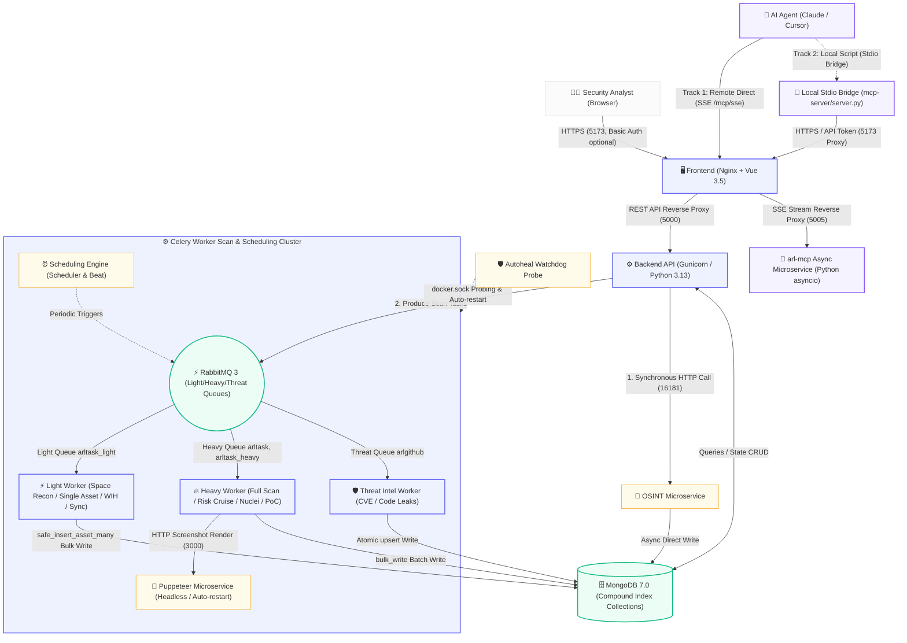

### Architectural Highlights

1. 🖥️ **Unified Gateway & Presentation (`Frontend / Nginx`)**: Built with **Vue 3.5 + Nginx**, exposing only port `5173` (HTTPS) externally with optional **Basic Auth protection**, unbuffered streaming reverse proxy (for MCP SSE and backup archive transfers), and a multilingual UI.
2. ⚙️ **Core API & Async MCP Service (`Backend / arl-mcp`)**: Main business APIs run on **Python 3.13 + Gunicorn**; persistent MCP SSE connections are isolated in a dedicated **`arl-mcp` (`asyncio`) container** to prevent long-lived streams from exhausting Web worker threads.
3. 🧩 **Dedicated Corporate Recon Service (`OSINT Service`)**: Handles Tianyancha and MIIT ICP lookups via direct HTTP calls from Backend (with a 5s timeout guard), isolated from Celery queues so long OSINT jobs do not stall regular scans.
4. ⚡ **Multi-Queue Worker Cluster (`Celery Cluster`)**: Splits workloads across **light**, **heavy**, and **threat-intel** queues with subprocess recycling and packet-phase concurrency leases to control memory growth and network contention; standardized on **Nmap 7.95 Stable**.
5. 🛡️ **Headless Browser Isolation & Watchdog (`Puppeteer / Autoheal`)**: Containerized headless screenshot service with request-count recycling; **Autoheal** periodically probes scan workers and automatically restarts unresponsive containers.
6. 🗄️ **Batch Persistence (`MongoDB 7.0`)**: High-frequency writes use `safe_insert_asset_many` and `bulk_write` batch APIs with compound unique indexes and a 1GB WiredTiger cache cap to balance ingestion throughput with host memory stability.

---

## 📜 Changelog

For detailed release notes, new capabilities, and bug fix history, see ➔ [**CHANGELOG_en.md**](./CHANGELOG_en.md)

---

## 🤝 Acknowledgements

ARL-Next benefits from the open-source security community. Special thanks to:

* **Open-Source Lineage**: Originally evolved from the open-source project [ARL (Asset Reconnaissance Lighthouse)](https://github.com/TophantTechnology/ARL), with community references from [Aabyss-Team/ARL](https://github.com/Aabyss-Team/ARL) and [adysec/ARL](https://github.com/adysec/ARL).
* **Fingerprint Repository**: Thanks to the **Weiling Security Team** (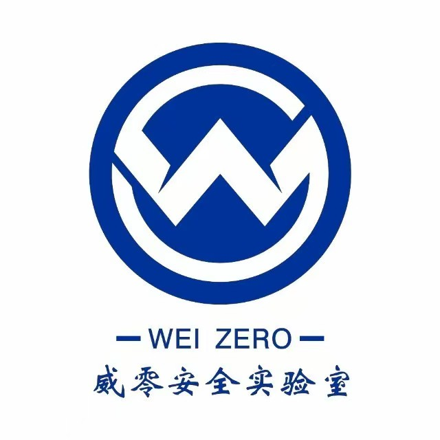 WeChat Official Account) for providing the Web technology fingerprint repository.
* **Module References**: Corporate OSINT and threat monitoring modules drew inspiration from [ICP_Query](https://github.com/HG-ha/ICP_Query) and [github-cve-monitor](https://github.com/yhy0/github-cve-monitor).

---

## 💖 Sponsorship & Support

Ongoing maintenance and development of ARL-Next are supported by the open-source community. Special thanks to our sponsors:

<p align="center">
  
</p>

<p align="center">
  <a href="https://github.com/robotfish001" target="_blank">
    
  </a>
  <a href="https://github.com/phpmac" target="_blank">
    
  </a>
  <a href="https://github.com/123lpone" target="_blank">
    
  </a>
  <a href="https://github.com/Qexzi" target="_blank">
    
  </a>
  <a style="cursor: default;">
    
  </a>
</p>

---

## ⚠️ Legal Notice & Disclaimer

> [!CAUTION]
> **Compliance & Legal Terms**:  
> This platform is intended solely for authorized enterprise security assessments, SRC vulnerability research, academic defensive simulations, and lawful penetration testing. Before conducting any scanning or reconnaissance, operators must obtain explicit written authorization from target asset owners and strictly comply with applicable local laws and regulations (including the Cybersecurity Law of the People's Republic of China).  
> **Engaging in unauthorized scanning, intrusion, or destructive activities using this tool is strictly prohibited.** Operators assume full civil and criminal liabilities arising from unauthorized misuse. The authors and project contributors disclaim all liability for damages or legal consequences incurred through the use or misuse of this software.

---

## 📄 License

ARL-Next is licensed under the [GNU General Public License v3.0 (GPL-3.0)](./LICENSE).

* 🆓 **Free & Open Source**: Permitted for enterprise deployment, security research, asset mapping, and penetration testing, with full rights to read, modify, and customize the source code.
* 🌐 **Copyleft & Share-Alike**: If you distribute modified versions or derivative works based on this project to third parties, you must release the corresponding source code under the same GPL-3.0 license.
* ⚖️ **Attribution & Disclaimer Retention**: All redistributions must retain original copyright notices, the license text, and disclaimer terms.

---

## 💬 Community & Feedback Channels

- 🐛 **Issues & Feature Requests**: Submit reports and suggestions via [GitHub Issues](https://github.com/owl234/ARL-Next/issues).
- 💡 **Discussions**: Join technical discussions on [GitHub Discussions](https://github.com/owl234/ARL-Next/discussions).
- 📢 **Chinese Community Channels**: Connect via WeChat or QQ group for asset mapping discussions and release updates.

<table align="center">
  <tr>
    <td align="center" style="padding: 10px 25px;"><b>👤 Personal WeChat</b></td>
    <td align="center" style="padding: 10px 25px;"><b>📢 WeChat Official (owl安全)</b></td>
    <td align="center" style="padding: 10px 25px;"><b>🐧 QQ Tech Group</b></td>
  </tr>
  <tr>
    <td align="center" style="padding: 10px 25px;"></td>
    <td align="center" style="padding: 10px 25px;"></td>
    <td align="center" style="padding: 10px 25px;">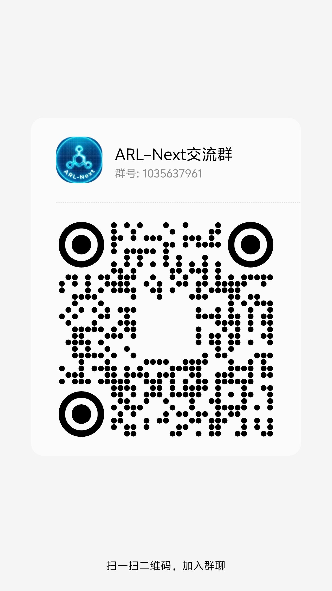</td>
  </tr>
</table>

---

## 🌟 Star History

<div align="center">

<a href="https://www.star-history.com/?repos=owl234%2Farl-next&type=date&legend=top-left">
 <picture>
   <source media="(prefers-color-scheme: dark)" srcset="https://api.star-history.com/chart?repos=owl234/arl-next&type=date&theme=dark&legend=top-left&sealed_token=vNF3XBBUYjnOkZ1XfTODaJEURB73qlNr1zXyCH6HOUbJGKju3QmIb7pVDyjCK67Ra-ukzG7dgZ3B3HDpCKJ3raveN9bOCec7r6gDILhjGrYbcVEV2Gy5Ew" />
   <source media="(prefers-color-scheme: light)" srcset="https://api.star-history.com/chart?repos=owl234/arl-next&type=date&legend=top-left&sealed_token=vNF3XBBUYjnOkZ1XfTODaJEURB73qlNr1zXyCH6HOUbJGKju3QmIb7pVDyjCK67Ra-ukzG7dgZ3B3HDpCKJ3raveN9bOCec7r6gDILhjGrYbcVEV2Gy5Ew" />
   
 </picture>
</a>

</div>
