<div align="center">

  <p>
    <b>English</b> |
    <a href="./README.md"><b>简体中文</b></a>
  </p>

  # ARL-Next
  **Modern Attack Surface Reconnaissance & Vulnerability Monitoring Platform**

  <p><b>Enterprise Asset Correlation · Async Decoupled Scheduling · Native MCP Support · Docker-Ready Deployment</b></p>

  <p>
    <a href="https://github.com/owl234/ARL-Next/releases"></a>
    <a href="https://github.com/owl234/ARL-Next/stargazers"></a>
    <a href="https://github.com/owl234/ARL-Next/network/members"></a>
    <a href="./LICENSE"></a>
  </p>

  <p>
    
    
    
    
    
    
  </p>

  <p>
    <a href="./docs/QUICKSTART_en.md"><b>🚀 Quickstart (5-Min)</b></a> •
    <a href="#quick-deploy"><b>⚡ Quick Deployment</b></a> •
    <a href="#comparison"><b>💡 Architectural Comparison</b></a> •
    <a href="#core-features"><b>✨ Core Features</b></a> •
    <a href="./docs/API_GUIDE_en.md"><b>🔌 API Guide</b></a> •
    <a href="./mcp-server/README_en.md"><b>🤖 MCP Guide</b></a> •
    <a href="./CHANGELOG_en.md"><b>📜 Changelog</b></a> •
    <a href="https://github.com/owl234/ARL-Next/discussions"><b>💬 Discussions</b></a> •
    <a href="./LICENSE"><b>📄 License</b></a>
  </p>
</div>

<br/>

---

## 💡 What is ARL-Next?

> **ARL-Next** is an asset mapping platform re-engineered from the classic open-source project ARL (Asset Reconnaissance Lighthouse).
> Addressing task-queue congestion in large-scale scans, memory growth during prolonged runs, and outdated dependencies, it uses microservice decoupling with async task isolation, upgraded runtimes and mapping toolchains, and a native **Model Context Protocol (MCP)** server for automated asset profiling and AI-assisted analysis.

---

### <span id="comparison"></span>💡 Architectural Evolution & Benchmark Comparison

| Evaluation Dimension | Legacy ARL Architecture & Implementation | ARL-Next Re-engineered Architecture |
| :--- | :--- | :--- |
| **Concurrency & Task Scheduling** | All scan tasks shared a single Celery queue, causing frequent queue stalling and process hangs under high concurrency | **Decoupled OSINT and screenshot capture into dedicated microservices**; implemented dual-track light/heavy task queues and bulk database persistence to resolve concurrency bottlenecks |
| **Automation Protocol Integration** | Lacked standardized external integration interfaces; restricted to manual Web UI interactions | **Supports native Python MCP Server**, providing standard protocol endpoints for multi-dimensional asset profiling |
| **Enterprise Asset Topology** | Lacked organizational equity mapping and multi-tier digital asset drill-downs | **Integrated Asset Group Management**: correlates corporate equity with multi-category ICP registrations (websites, APPs, mini-programs, quick apps) to construct hierarchical group topologies |
| **Containerization & Delivery** | Outdated dependencies lacking mirror acceleration; vulnerable to network disruption during installation | **Multi-stage Docker builds with pre-compiled artifacts on Alibaba Cloud ACR**, enhancing build reliability and rapid container deployment |
| **Runtime Environment Baseline** | Python 3.6 / Vue 2 / MongoDB 3.x / Nmap 7.70 | **Python 3.13 / Vue 3.5 / MongoDB 7.0 / Nmap 7.95 Stable**; modernized runtime baseline |
| **Sensitive Data Extraction** | Relied on external Go binaries with cross-platform build and runtime overhead | **Pure-Python streaming extraction engine**, sensitive data module requires no external binary dependencies, supporting stream extraction |
| **Web UI / User Experience** | Long tables lacked sticky headers, pagination states were lost on refresh, and policy menus were fragmented | **Sticky table headers and floating action bars**, local pagination state persistence, and a modern 3-pane dictionary manager |
| **Threat Intelligence Integration** | Lacked continuous intelligence feeds; unaligned timestamps led to redundant alerts | **Automated CVE synchronization & GitHub credential leak monitoring**, deduplicated via database atomic upsert locks with strict timezone normalization |

---

### <span id="core-features"></span>✨ Core Feature Matrix

* 🤖 **Native AI Agent Integration (MCP 2.0)**: Compliant with the Model Context Protocol (2024-11-05) standard, providing dual-mode support for **Remote Native SSE Direct Connection** (copy-paste ready for Cursor / Claude Desktop) and **Local Stdio Bridge** (out-of-the-box for self-signed certificates / private networks); decoupled via an independent asynchronous microservice container to isolate long-lived connections, covering 5-dimensional asset profiling, conditional query, status tracking, and controlled scan task dispatch. (👉 [MCP Configuration Guide](./mcp-server/README_en.md))
* ⚙️ **Asynchronous Decoupled Scheduling**: Microservice isolation with dedicated queues and bulk MongoDB operations ensures stable execution under high-throughput scanning workloads.
* 🌐 **Hierarchical Asset Group Management**: Integrated corporate asset discovery supporting multi-tier organizational structures, multi-category ICP association (Web / APP / Mini-program / Quick App), and unified attack surface mapping.
* 🔍 **Modern Reconnaissance Baseline**: Standardized on Nmap 7.95 Stable; native Python streaming engine for sensitive information and credential discovery.
* 🛡️ **Vulnerability & Leak Monitoring**: Continuous tracking of authoritative CVE feeds and automated GitHub credential leak monitoring with atomic lock deduplication.
* ⚡ **High Availability & Fault Tolerance**: Container health probes, readiness polling, automated container watchdog auto-restart, and seamless web-based updates.
* 📦 **Pre-built Container Images**: Pre-compiled multi-stage container images on Alibaba Cloud ACR minimize network latency and dependency installation failures.

---

## 📸 Interface Preview

* **Global Dashboard**: Real-time visualization of attack surface posture, active reconnaissance pipelines, vulnerability distribution, and threat feeds. Features CPU/memory/disk telemetry, task queue queues, security dispatch log streams, and TOP 5 Web technology fingerprints.
  
  <p align="center">
    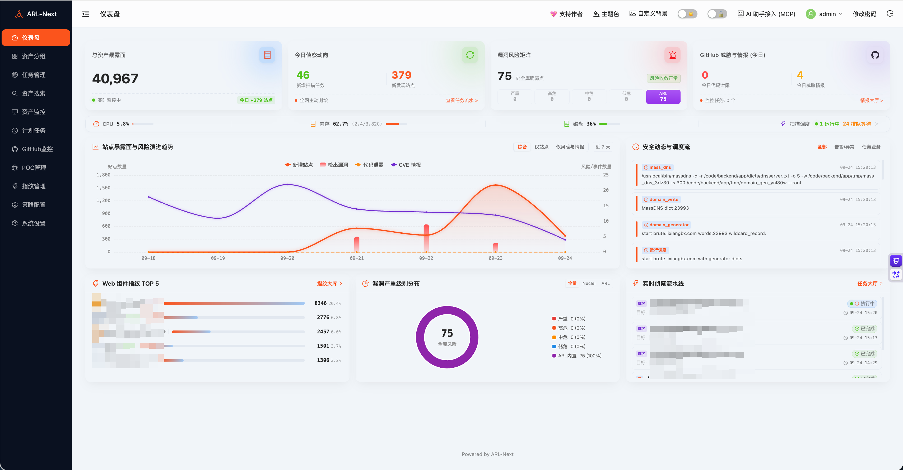
  </p>

<details open>
<summary><b>🖼️ Click to expand / collapse core application views</b></summary>

<br/>

* **Hierarchical Asset Groups & Panoramic Asset Profile**: Enterprise asset reconnaissance integrated into a unified grouping architecture. Supports multi-tier organizational hierarchy, corporate OSINT asset correlation, attack surface management (ASM), and asset profile drill-downs (the profile drawer aggregates 13 dimensions, whereas the Asset Search page exposes 12 tab dimensions, excluding Nuclei results).
  
  <p align="center">
    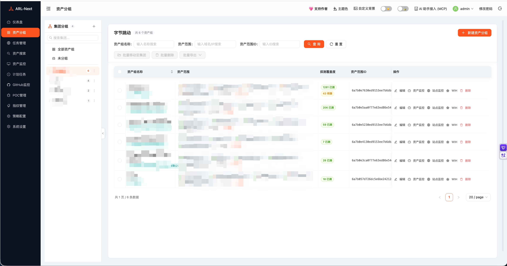
  </p>
  
  <p align="center">
    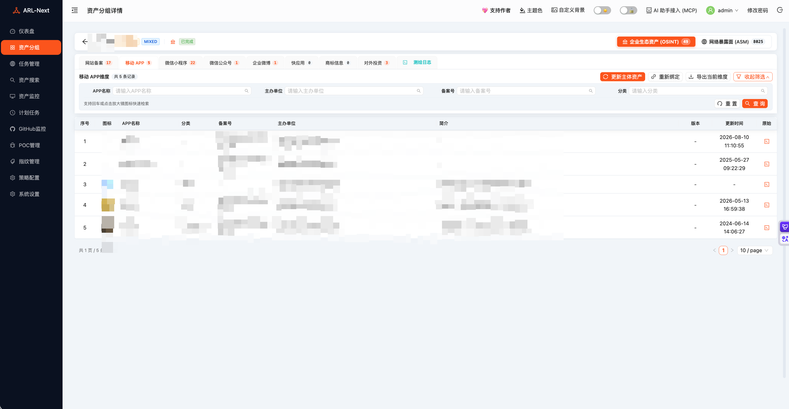
  </p>
  
  <p align="center">
    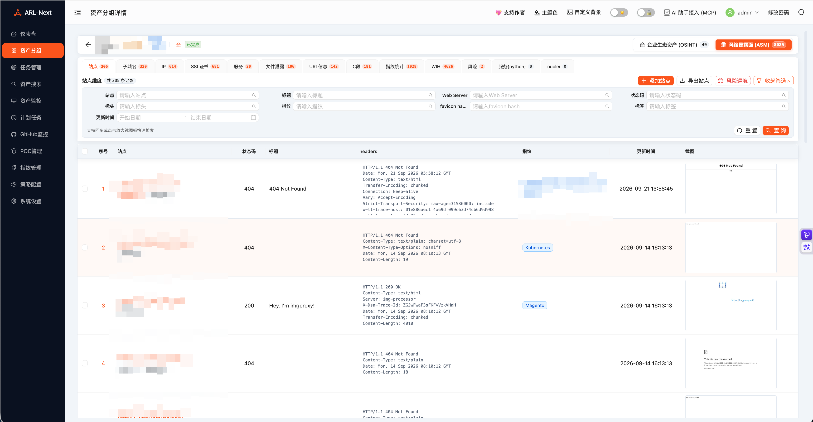
  </p>
  
  <p align="center">
    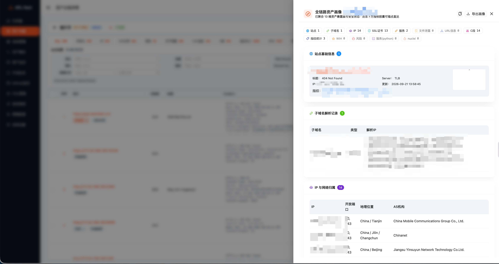
  </p>

* **Task Dispatch & Policy Scheduling**: Integrates Nuclei orchestration, a pure-Python multi-category plugin pool (PoC verification, credential brute-forcing, service identification), and an 8,800+ entry Web technology fingerprint repository with end-to-end task lifecycle tracking.
  
  <p align="center">
    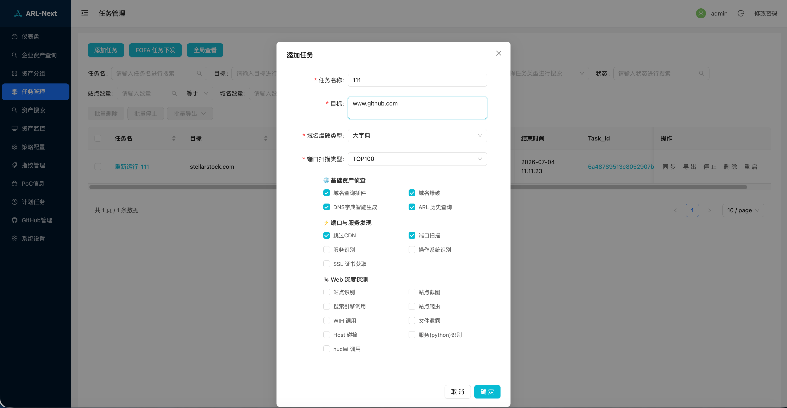
  </p>
  
  <p align="center">
    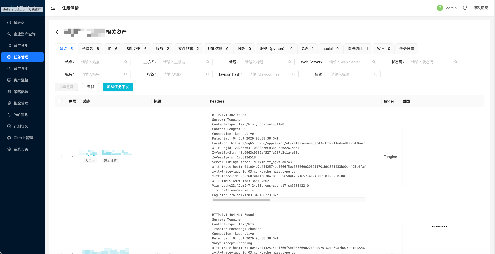
  </p>

* **Threat Intelligence & Credential Leak Radar**: Real-time surveillance of global CVE vulnerabilities and automated tracking of sensitive code or credential disclosures on GitHub.
  
  <p align="center">
    
  </p>

* **System Settings & Modern Wordlist Manager**: Modern 3-pane wordlist manager with instant file preview and health indicators, dynamic worker concurrency scaling, and alert channel configurations.
  
  <p align="center">
    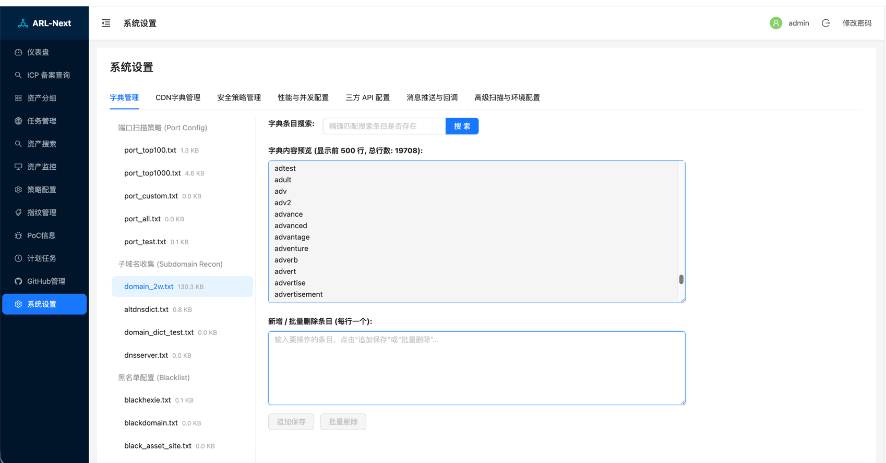
  </p>

</details>

---

## 🏗️ Architecture Design

ARL-Next adopts a decoupled frontend-backend architecture with asynchronous distributed Celery task queues and lightweight microservices. The overall dataflow and component topology are illustrated below:

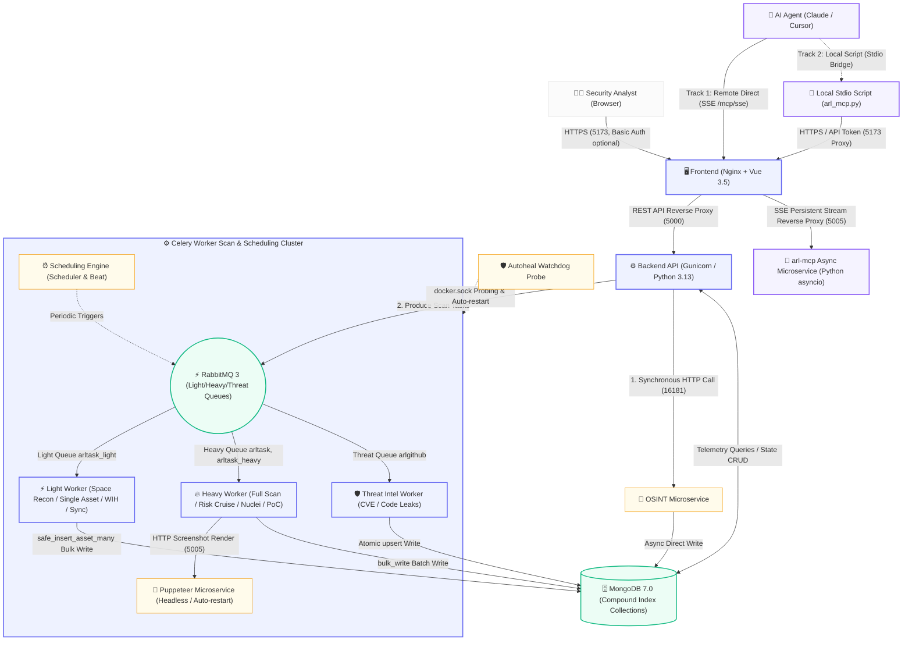

### Key Architectural Highlights:

1. 🖥️ **Presentation & Gateway (Frontend / Nginx)**: Built with **Vue 3.5 + Nginx**, featuring core table sticky headers and floating action toolbars; provides **frontline Basic Auth gateway protection** (disabled by default, toggleable from the top navigation bar).
2. ⚙️ **Core API & Protocol Integration (Backend / MCP)**: Main business logic powered by **Python 3.13 + Gunicorn**; equipped with a dedicated **`arl-mcp` asynchronous microservice container** natively handling MCP SSE persistent streams and standard protocol endpoints for multi-dimensional asset profiling and controlled task dispatch.
3. 🧩 **Dedicated OSINT Microservice**: Dedicated engine for corporate asset discovery and ICP lookup; invoked synchronously by the backend over HTTP (5s timeout guard) and **isolated from Celery scan queues to prevent long-running tasks from stalling them**.
4. ⚡ **Multi-Queue Worker Cluster**: Segregated into **lightweight**, **heavyweight**, and **threat intelligence** task queues; controls worker memory growth through subprocess lifecycle recycling; standardizes on **Nmap 7.95 Stable**.
5. 🛡️ **Microservices & Autoheal Watchdog (Puppeteer / Autoheal)**: Containerized headless browser isolation with request-count recycling; **Autoheal watchdog periodically checks scan workers and automatically restarts unresponsive containers**; pure Python engine for streaming sensitive data discovery.
6. 🗄️ **High-Throughput Persistence (MongoDB 7.0)**: High-throughput asset ingestion utilizes `bulk_write` and `safe_insert_asset_many` batch interfaces; compound unique indexes across core collections backed by a 1GB memory buffer pool to maintain scanning throughput and database stability.

---

## <span id="quick-deploy"></span>🚀 Deployment Guide

### Production Deployment (Recommended)

**Target Environments**: Public Cloud VMs (Ubuntu / Debian / CentOS / RHEL / Rocky Linux, etc.) or Enterprise Internal Servers.  
**Recommended Specs**: 4-Core CPU, 4GB RAM or higher (ensures stability for multi-task concurrency and large-scale scanning).  
**Estimated Time**: Typically completes within minutes on a host with Docker already installed; on bare metal, Docker installation and Swap configuration add further time depending on host and network conditions.

**Key Operational Advantages**:
* ⚡ **Mainland China Mirror Acceleration**: Pulls directly from the Alibaba Cloud ACR private mirror repository, avoiding cross-border network timeouts and pull interruptions.
* 📦 **Out-of-the-Box Delivery**: Pre-built container images eliminate local toolchain compilation and dependency configuration.
* 🛡️ **Dual-Layer Security**: Bundled local SSL encryption; **frontline Basic Auth gateway protection is disabled by default** (toggleable from the top navigation bar); core internal services isolated within a private Docker bridge network.
* 🔄 **Background Hot Updates**: Trigger an online upgrade from the web console; the background daemon pulls updated images and orchestrations automatically.
* 🩺 **Health Readiness Probing**: Integrated startup probe loops verify API readiness before allowing incoming traffic, preventing intermittent startup errors.

---

#### 🚀 Deployment Methods

**For the vast majority of setups, just run "Method 1" below** — no need to determine your OS or network environment first; the script auto-detects the system, installs missing dependencies, and tunes kernel parameters.

##### Method 1: Accelerated Mirror Deployment (Recommended)

On your server terminal (root required), paste and run the command below. It extracts the deployment orchestration from the Alibaba Cloud ACR mirror, and `start-prod.sh` then configures Swap, installs/pads Docker and the Compose plugin, and brings the stack up:

```bash
mkdir -p ~/ARL-Next && cd ~/ARL-Next && \
docker pull crpi-laul1izptqrf0tkf.cn-beijing.personal.cr.aliyuncs.com/owl234-arl-prod/arl-web:latest && \
docker rm -f arl-temp 2>/dev/null || true && \
docker create --name arl-temp crpi-laul1izptqrf0tkf.cn-beijing.personal.cr.aliyuncs.com/owl234-arl-prod/arl-web:latest && \
docker cp arl-temp:/code/start-prod.sh ./ && \
docker cp arl-temp:/code/docker-compose.prod.yml ./ && \
docker cp arl-temp:/code/updater ./ && \
docker cp arl-temp:/code/version.txt ./ && \
docker cp arl-temp:/code/CHANGELOG.md ./ && \
docker cp arl-temp:/code/CHANGELOG_en.md ./ && \
mkdir -p ./frontend && docker cp arl-temp:/code/frontend/default.conf.prod ./frontend/ && \
docker rm -f arl-temp && \
chmod +x start-prod.sh && bash start-prod.sh
```

> [!TIP]
> If Docker is not yet installed on the host, run step 1 of "Method 2" below first, then return to this command.

<details>
<summary><b>Method 2: Full Manual Commands (by OS type)</b></summary>
<br/>

The two commands below differ **only in how base tools are installed** (choose `apt-get` or `yum`); the second step is identical for all systems.

**Step 1: Install base tools and create the directory**

- Ubuntu / Debian / UOS:
  ```bash
  apt-get update && apt-get install -y docker.io openssl curl && \
  (systemctl enable --now docker 2>/dev/null || service docker start 2>/dev/null || true)
  ```
- CentOS / RHEL / Alibaba Cloud Linux / TencentOS:
  ```bash
  yum install -y openssl curl && \
  (command -v docker &>/dev/null || curl -fsSL https://get.docker.com | bash -s docker --mirror Aliyun) && \
  systemctl enable --now docker 2>/dev/null || true
  ```

**Step 2: Pull orchestration files and start (identical for all systems)**

```bash
mkdir -p ~/ARL-Next && cd ~/ARL-Next && \
docker pull crpi-laul1izptqrf0tkf.cn-beijing.personal.cr.aliyuncs.com/owl234-arl-prod/arl-web:latest && \
docker rm -f arl-temp 2>/dev/null || true && \
docker create --name arl-temp crpi-laul1izptqrf0tkf.cn-beijing.personal.cr.aliyuncs.com/owl234-arl-prod/arl-web:latest && \
docker cp arl-temp:/code/start-prod.sh ./ && \
docker cp arl-temp:/code/docker-compose.prod.yml ./ && \
docker cp arl-temp:/code/updater ./ && \
docker cp arl-temp:/code/version.txt ./ && \
docker cp arl-temp:/code/CHANGELOG.md ./ && \
docker cp arl-temp:/code/CHANGELOG_en.md ./ && \
mkdir -p ./frontend && docker cp arl-temp:/code/frontend/default.conf.prod ./frontend/ && \
docker rm -f arl-temp && \
chmod +x start-prod.sh && bash start-prod.sh
```

</details>

<details>
<summary><b>Method 3: Git Clone Source Deployment (Overseas servers / modifying source)</b></summary>
<br/>

```bash
git clone --depth 1 https://github.com/owl234/ARL-Next.git && cd ARL-Next
chmod +x start-prod.sh
bash start-prod.sh
```

> [!TIP]
> `start-prod.sh` includes environment probes that also install Docker and tune kernel parameters on bare-metal systems.

</details>

---

#### 🔑 Access & Default Credentials

After deployment completes, open your browser and navigate to: `https://<YOUR_SERVER_IP>:5173` (bypass the self-signed certificate warning on first visit).

| Authentication Layer | Default Username | Default Password | Description |
| :--- | :--- | :--- | :--- |
| **Layer 1: Nginx Basic Auth Gateway** | `admin` | `arl_next` | Prevents automated internet scanner brute-forcing. Disabled by default; can be toggled via the security switch in the top navigation bar. |
| **Layer 2: ARL-Next System Login** | `admin` | Randomly generated on first startup | Existing passwords are preserved; new passwords require at least 12 characters. |

On a trusted host, run `docker exec arl-web-prod cat /tmp/arl_initial_admin_password` to read the initial password. The file is mode `0600`; the password is never printed in startup logs. Alternatively, set `ARL_ADMIN_PASSWORD` to at least 12 characters before first startup. Remove the bootstrap file after changing the password and confirming login. Upgrades preserve existing accounts; deployments using the old default password must change it explicitly.

Login sessions expire after 24 hours. Long-running API/MCP integrations should use a separately configured `API_KEY` in the `Token` header. See [API authentication](docs/API_GUIDE_en.md#2-authentication--security-policy).

> [!IMPORTANT]
> **Required**: Ensure port **5173** (TCP) is allowed in your cloud provider security groups and local firewall, otherwise the console will be unreachable.
> ```bash
> # Ubuntu / Debian
> ufw allow 5173/tcp
> # CentOS / RHEL
> firewall-cmd --permanent --add-port=5173/tcp && firewall-cmd --reload
> ```

> [!TIP]
> **Optional optimizations** (not required for basic operation):
> - **Custom SSL Certificates**: Place your official certificates renamed as `arl.crt` and `arl.key` into the `ssl-certs/` directory, then re-run `bash start-prod.sh`.
> - **Enable Basic Auth**: Toggle the security switch in the top navigation bar after logging in (disabled by default).

---

### 🔄 Upgrading in Production

ARL-Next offers two upgrade paths: **Web Console Online Update** (recommended, no terminal required) and **Standard Terminal Upgrade**.

#### Option 1: Web Console Online Update (Recommended)

Log in to ARL-Next ➔ Navigate to **"System Settings"** ➔ Click **"One-Click System Update"**.<br/>
The host update daemon pulls the latest images, synchronizes orchestration scripts, and performs service health checks in the background without requiring SSH access.

> [!WARNING]
> The update restarts the background Worker container, which **interrupts any running scan tasks** (they will be marked as interrupted). Run it during idle periods.

<details>
<summary><b>Option 2: Standard Terminal Upgrade</b></summary>
<br/>

Navigate to your ARL-Next installation directory and run the commands matching your installation method.

- **Method 1 / Method 2 users** (no Git, syncing orchestration from the image):
  ```bash
  cd ~/ARL-Next && \
  docker pull crpi-laul1izptqrf0tkf.cn-beijing.personal.cr.aliyuncs.com/owl234-arl-prod/arl-web:latest && \
  docker run --rm -v $(pwd):/host crpi-laul1izptqrf0tkf.cn-beijing.personal.cr.aliyuncs.com/owl234-arl-prod/arl-web:latest bash -c "cp /code/start-prod.sh /host/start-prod.sh && cp /code/docker-compose.prod.yml /host/docker-compose.prod.yml && mkdir -p /host/updater && cp -r /code/updater/. /host/updater/ 2>/dev/null || true; mkdir -p /host/frontend && cp /code/frontend/default.conf.prod /host/frontend/default.conf.prod 2>/dev/null || true; cp /code/version.txt /host/version.txt 2>/dev/null || true; cp /code/CHANGELOG.md /host/CHANGELOG.md 2>/dev/null || true; cp /code/CHANGELOG_en.md /host/CHANGELOG_en.md 2>/dev/null || true" && \
  sudo bash start-prod.sh
  ```

- **Method 3 users** (Git clone):
  ```bash
  cd ~/ARL-Next && git pull && sudo bash start-prod.sh
  ```

</details>

> [!TIP]
> **Upgrade Safeguards**:
> - **Incremental Database Schema Evolution**: Automatically preserves collection structures and compound unique indexes, mitigating upgrade conflicts.
> - **Image Backup Tags**: Tags existing running images with `backup-stable` prior to pulling new images, allowing quick rollback in case of runtime anomalies.
> - **Readiness Probing**: Validates API responsiveness dynamically before releasing traffic.

---

## 🔌 Developer API & Integration

ARL-Next provides standardized RESTful APIs for automation scripts, CI/CD pipelines, and security orchestration (SOAR) integrations.

* 📖 **Interactive Swagger UI**: After deployment, access `https://<your-arl-host>:5173/api/doc` in your browser to inspect full OpenAPI schemas and test endpoints interactively.
* 📘 **Calling Conventions & Gotchas**: For token authentication, task lifecycle constraints, HTTP method conventions (e.g., GET for stopping tasks), and asset query namespaces, refer to ➔ [**API Calling Guide (API_GUIDE_en.md)**](./docs/API_GUIDE_en.md).

---

## ❓ FAQ & Troubleshooting

<details open>
<summary><b>Q1: Browser warns "Your connection is not private / Not Secure" on first HTTPS access?</b></summary>
<br/>

**A:** The system generates a local self-signed SSL certificate upon first startup.
- Click **"Advanced" ➔ "Proceed to (unsafe)"** in your browser to continue (in Chromium browsers, typing `thisisunsafe` on the error page will bypass the warning).
- **Configure Custom Domain Certificates**: Rename your commercial certificate files to `arl.crt` and `arl.key`, place them into the `ssl-certs/` directory, and run `bash start-prod.sh` to apply.
</details>

<details>
<summary><b>Q2: What should I do if I forget the admin password or Basic Auth credentials?</b></summary>
<br/>

**A:** Execute the following commands on the server terminal to reset credentials:
- **Reset Platform Admin Account (admin)**:
  ```bash
  docker exec -it arl-web-prod /code/backend/.venv-docker/bin/python3 /code/backend/inject_user.py --reset
  ```
  > [!NOTE]
  > Startup preserves existing passwords. `--reset` generates a new random password and revokes the login session; read it from `/tmp/arl_initial_admin_password` inside the container. If `ARL_ADMIN_PASSWORD` is set, that value is used instead. Run only from a trusted host shell.
- **Reset or View Basic Auth Credentials**: Edit `frontend/.htpasswd` in your deployment directory, or toggle the Basic Auth switch in the web top navigation bar after logging in (to change the password, disable and re-enable it).
</details>

<details>
<summary><b>Q3: Web console displays <code>[ERROR] Trigger update failed</code> when clicking "One-Click System Update"?</b></summary>
<br/>

**A:** This typically occurs when the host updater daemon is inactive. Resolve via either of the following:
- **Option A (Recommended)**: Perform a standard manual terminal upgrade:
  ```bash
  cd ~/ARL-Next && sudo bash start-prod.sh
  ```
- **Option B**: Restart the updater service and retry from the Web console:
  ```bash
  sudo systemctl restart arl-updater.service
  ```
</details>

<details>
<summary><b>Q4: How do I adjust scan concurrency under high workload volume?</b></summary>
<br/>

**A:** ARL-Next supports **dynamic live concurrency tuning** without restarting containers:
- Log in to the web console ➔ **"System Settings"** ➔ **"Scanning & Concurrency"** ➔ **"Task Queue Concurrency"** tab;
- Adjust **Heavy Task Queue Concurrency** (Domain/IP port scanning, risk cruising, Nuclei / PoC pipelines), **Light Task Queue Concurrency** (Space reconnaissance, single asset updates, WIH leak extraction, data synchronization) and **OSINT Concurrency**; save changes for instant application;
- All three values are **Worker process counts** (typically 1–128) bounded by host memory. The UI derives a recommendation from detected memory and offers one-click fill.
- ⚠️ To tune the **intra-task DNS brute-force send concurrency** (typically hundreds to thousands), go to **"Scanning & Concurrency"** ➔ **"Advanced Scanning & Environment"**. The two are different metrics — do not use the same magnitude for both.
</details>

<details>
<summary><b>Q5: Quick reference commands for Docker container maintenance and log inspection?</b></summary>
<br/>

```bash
# Check container statuses and health probes
docker compose -f docker-compose.prod.yml ps

# Inspect scan worker execution logs in real time
docker compose -f docker-compose.prod.yml logs -f arl-worker

# Gracefully restart all services
docker compose -f docker-compose.prod.yml restart
```
</details>

<details>
<summary><b>Q6: Frontend container crashes or port 5173 is inaccessible on legacy kernels like CentOS 7 / Linux 3.x?</b></summary>
<br/>

**A:** On legacy kernels such as Linux 3.10, Docker's default Seccomp profile may intercept modern system calls (e.g., `SYS_pwritev2` or newer libc write routines), preventing Nginx from writing its PID file (triggering `pwrite() "/run/nginx.pid" failed (1: Operation not permitted)`) and causing a container restart loop.

**Remediation Steps**:
1. **Verify Compose Configuration**: The latest `docker-compose.prod.yml` includes `security_opt: [seccomp:unconfined]` under `arl-frontend` by default.
2. **Quick Fix for Existing Deployments**: If your deployment was initialized with an earlier compose file lacking this setting, apply the patch and recreate the frontend container (idempotent, safe to run multiple times):
   ```bash
   # Add unconfined seccomp option under arl-frontend (if not already present)
   grep -q "seccomp:unconfined" docker-compose.prod.yml || sed -i '/container_name: arl-frontend-prod/a \    security_opt:\n      - seccomp:unconfined' docker-compose.prod.yml
   # Recreate frontend container
   docker compose -f docker-compose.prod.yml up -d arl-frontend
   ```
3. **Re-run Deployment Verification**: Execute `bash start-prod.sh`. The built-in health assertion and connectivity probe will verify that the service is operational.
</details>

---

## 📜 Changelog

For detailed version history, feature additions, performance enhancements, and bug fixes, refer to ➔ [**CHANGELOG_en.md**](./CHANGELOG_en.md)

---

## 🤝 Acknowledgements

ARL-Next stands on the shoulders of giants. Special thanks to the following projects and teams:

* **Core Architecture**: Re-engineered from the open-source project [ARL (Asset Reconnaissance Lighthouse)](https://github.com/TophantTechnology/ARL), with architectural references from [Aabyss-Team/ARL](https://github.com/Aabyss-Team/ARL) and [adysec/ARL](https://github.com/adysec/ARL).
* **Fingerprint Data**: Special appreciation to the **Weiling Security Team** (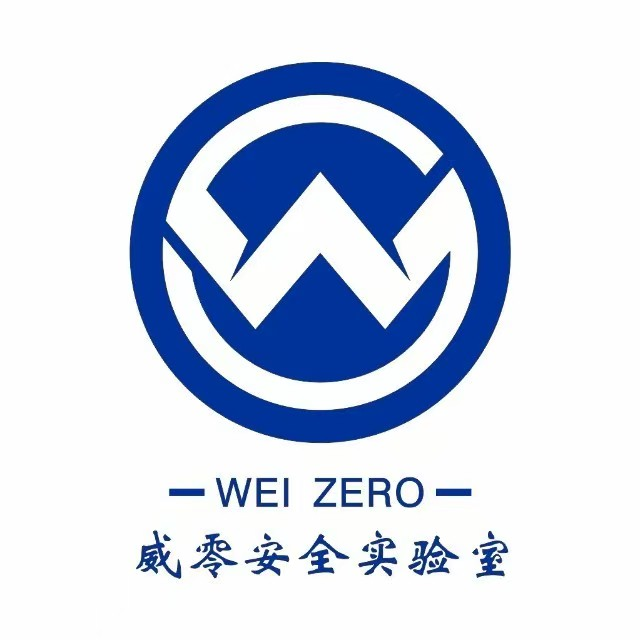 WeChat Official Account) for providing the high-quality Web technology fingerprint repository.
* **Functional Inspirations**: Corporate OSINT modules reference [ICP_Query](https://github.com/HG-ha/ICP_Query); threat intelligence tracking incorporates designs from [github-cve-monitor](https://github.com/yhy0/github-cve-monitor).

ARL-Next remains dedicated to open-source collaboration, providing reliable tooling for offensive reconnaissance and defensive asset management.

---

## 💖 Sponsorship & Support

Continuous development of ARL-Next is supported by our open-source community. Special thanks to our sponsors:

<p align="center">
  
</p>

<p align="center">
  <a href="https://github.com/robotfish001" target="_blank">
    
  </a>
  <a href="https://github.com/phpmac" target="_blank">
    
  </a>
  <a href="https://github.com/123lpone" target="_blank">
    
  </a>
  <a href="https://github.com/Qexzi" target="_blank">
    
  </a>
  <a style="cursor: default;">
    
  </a>
</p>

---

## ⚠️ Legal Notice & Disclaimer

> [!CAUTION]
> **Compliance & Legal Terms**:  
> This platform is intended solely for authorized enterprise security assessments, SRC vulnerability research, academic defensive simulations, and lawful penetration testing. Before conducting any scanning or reconnaissance, operators must obtain explicit written authorization from target asset owners and strictly comply with applicable local laws and regulations (including the Cybersecurity Law of the People's Republic of China).  
> **Engaging in unauthorized scanning, intrusion, or destructive activities using this tool is strictly prohibited.** Operators assume full civil and criminal liabilities arising from unauthorized misuse. The authors and project contributors disclaim all liability for damages or legal consequences incurred through the use or misuse of this software.

---

## 📄 License

The ARL-Next project is licensed under the [GNU General Public License v3.0 (GPL-3.0)](./LICENSE).

* 🆓 **Free & Open Source**: Permitted for enterprise deployment, security research, asset mapping, and penetration testing, with full rights to read, modify, and customize source code.
* 🌐 **Copyleft & Share-Alike**: If you distribute modified versions or derivative works based on this project to third parties, you must release corresponding source code under the same GPL-3.0 license.
* ⚖️ **Attribution & Disclaimer Retention**: All distributions of source code must retain original copyright notices, license text, and disclaimer terms.

---

## 💬 Community & Feedback Channels

- 🐛 **Issue Reporting & Feature Requests**: Submit feedback via [GitHub Issues](https://github.com/owl234/ARL-Next/issues); tracked and reviewed regularly.
- 💡 **Discussions**: Engage in architecture and feature discussions via GitHub Issues and Discussions.
- 📢 **Chinese Community Channels**: Connect via WeChat or QQ group for asset mapping discussions and release updates.

<table align="center">
  <tr>
    <td align="center" style="padding: 10px 25px;"><b>👤 Personal WeChat</b></td>
    <td align="center" style="padding: 10px 25px;"><b>📢 WeChat Official (owl安全)</b></td>
    <td align="center" style="padding: 10px 25px;"><b>🐧 QQ Tech Group</b></td>
  </tr>
  <tr>
    <td align="center" style="padding: 10px 25px;"></td>
    <td align="center" style="padding: 10px 25px;"></td>
    <td align="center" style="padding: 10px 25px;">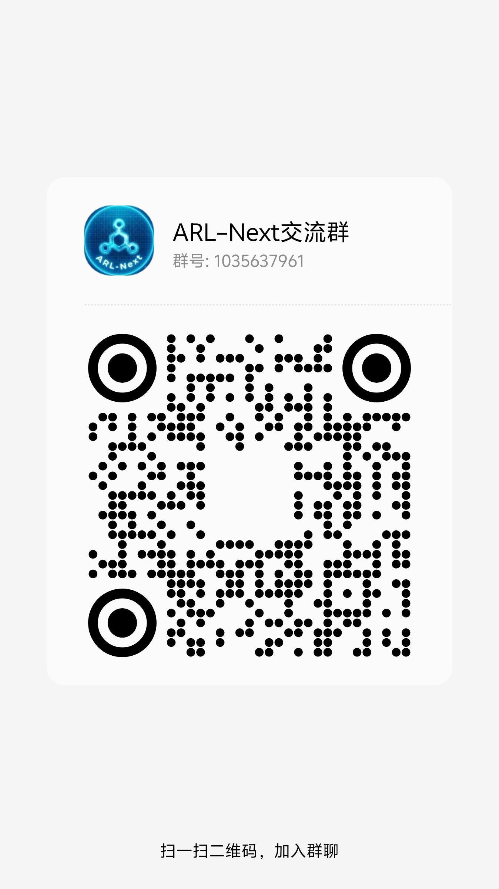</td>
  </tr>
</table>

---

## 🌟 Star History

<div align="center">

<a href="https://www.star-history.com/?repos=owl234%2Farl-next&type=date&legend=top-left">
 <picture>
   <source media="(prefers-color-scheme: dark)" srcset="https://api.star-history.com/chart?repos=owl234/arl-next&type=date&theme=dark&legend=top-left&sealed_token=vNF3XBBUYjnOkZ1XfTODaJEURB73qlNr1zXyCH6HOUbJGKju3QmIb7pVDyjCK67Ra-ukzG7dgZ3B3HDpCKJ3raveN9bOCec7r6gDILhjGrYbcVEV2Gy5Ew" />
   <source media="(prefers-color-scheme: light)" srcset="https://api.star-history.com/chart?repos=owl234/arl-next&type=date&legend=top-left&sealed_token=vNF3XBBUYjnOkZ1XfTODaJEURB73qlNr1zXyCH6HOUbJGKju3QmIb7pVDyjCK67Ra-ukzG7dgZ3B3HDpCKJ3raveN9bOCec7r6gDILhjGrYbcVEV2Gy5Ew" />
   
 </picture>
</a>

</div>
