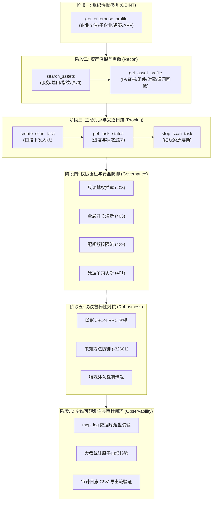

<div align="center">
  <p>
    <a href="./MCP_PENTEST_TEST_CASES_en.md"><b>English</b></a> |
    <b>简体中文</b>
  </p>
</div>

# ARL-Next MCP 渗透测试实战用例体系与可观测性方案

> 本方案聚焦日常渗透测试与红蓝对抗实战场景，针对 ARL-Next 平台的 Model Context Protocol (MCP) 服务治理中心，构建覆盖全生命周期的测试用例矩阵与全维立体可观测性验证闭环。<br>
> 涵盖外网情报测绘、资产指纹透视、受控扫描调度、权限风控围栏、报文协议对抗及全链路审计取证 6 大阶段，共 23 项核心测试用例。

---

## 1. 方案背景与渗透实战映射

在现代 AI 辅助渗透测试（AI-Augmented Penetration Testing）中，安全渗透工程师通过 AI 智能体（如 Cursor、Windsurf、Claude Code、Claude Desktop 或 Antigravity）驱动 MCP 协议连接 ARL-Next 资产平台。整个实战交互链条遵循标准的红队攻击生命周期（PTES 规范）：



---

## 2. 可观测性验证维度规范

测试过程的可观测性贯穿端到端每一个环节，必须达成三个层面的交叉印证：

| 可观测层级 | 观测目标与载体 | 验证指标与检查点 |
| :--- | :--- | :--- |
| **客户端实时观测** | 终端实时 ANSI/Rich 交互流 | - JSON-RPC 2.0 报文 ID、请求方法、入参结构化染色展示<br>- 毫秒级网络与处理耗时 (`duration_ms`)<br>- SSE 长连接状态流与心跳响应 |
| **服务端落盘观测** | 后端 MongoDB `mcp_log` 集合 | - 真实调用记录写入（无丢单、无静默失败）<br>- 操作人、凭据前缀 (`key_prefix`)、客户端 IP 提取<br>- 敏感字段脱敏与入参摘要长度控制 (`params_summary` ≤ 200B)<br>- 状态字段严谨性 (`success` / `error` / `denied`) |
| **大盘与治理观测** | REST `/api/mcp/overview` 与审计导出 | - `today_calls` 今日调用量精确原子自增比对<br>- 热门工具排行榜 (`top_tools`) 调用频次增量校准<br>- 审计日志 CSV 导出接口流式验证（公式注入防御检测） |

---

## 3. 测试环境前置与生命周期自愈红线

1. **凭据安全与零污染**：
   - 严禁在测试脚本中硬编码任何生产密码、私钥或完整系统 Token。
   - 所有测试用例均通过管理接口动态签发带有生命周期限制的专用测试 Key（如 `arl_mcp_test_*`）。
   - 测试退出时（包括正常完成、断言失败、手动中断 `SIGINT/SIGTERM`），通过退出钩子强制吊销并物理删除临时 Key，确保靶场数据库零污染。
2. **扫描调度安全沙箱原则**：
   - 默认模式下，调度类用例（`create_scan_task`）在完成入队确认及状态验证后，必须在数秒内自动调用 `stop_scan_task` 进行紧急熔断清理，杜绝算力资源浪费或误扫。
   - 仅在显式传入 `--live-fire` 授权参数时，才允许任务保持执行以验证全周期扫描资产回流。
3. **状态术语对齐**：
   - 任务状态值严格对齐全项目唯一基准：`running` (进行中)、`waiting` (排队中)、`done` (已完成)、`stop` (已停止)、`error` (异常失败)；插件阶段必须以 `进行中 · <阶段名>` 标注。

---

## 4. 渗透测试实战用例矩阵 (23 项)

### 阶段一：组织背景与供应链测绘 (OSINT & Enterprise Recon)

#### 用例 TC-PENTEST-MCP-01: 企业全景画像总览探测
- **测试目标**：验证渗透初期调用企业画像接口能否快速获取目标企业工商背景、ICP 备案及多维资产概览指标。
- **协议通道**：Remote SSE / Local Stdio
- **测试载荷**：
  ```json
  {
    "jsonrpc": "2.0",
    "id": 101,
    "method": "tools/call",
    "params": {
      "name": "get_enterprise_profile",
      "arguments": {
        "target": "example.com",
        "category": "all"
      }
    }
  }
  ```
- **预期响应**：
  - HTTP 状态码：`200`（SSE 接收响应帧）
  - `result.isError`: `false`
  - 返回 JSON 包含 `enterprise_name`、`categories` 统计分布字典、`status: "ok"`
- **可观测性核验点**：
  - 客户端：记录调用耗时，验证解析字段完整性。
  - 服务端：`mcp_log` 成功新增一条记录，`tool_name: "get_enterprise_profile"`，`status: "success"`，`target: "example.com"`。

#### 用例 TC-PENTEST-MCP-02: Web 域名与互联网暴露面下钻
- **测试目标**：验证对企业资产中的备案网站进行精准下钻与分页查询能力。
- **协议通道**：Remote SSE / Local Stdio
- **测试载荷**：
  ```json
  {
    "jsonrpc": "2.0",
    "id": 102,
    "method": "tools/call",
    "params": {
      "name": "get_enterprise_profile",
      "arguments": {
        "target": "example.com",
        "category": "web",
        "page": 1,
        "size": 10
      }
    }
  }
  ```
- **预期响应**：
  - `result.isError`: `false`
  - 返回对象包含 `items` 列表（包含网站域名、标题、备案号），`total` 与当前 `page` 一致。
- **可观测性核验点**：
  - 服务端审计：`mcp_log` 中 `params_summary` 包含 `category: "web"`，耗时记录正常。

#### 用例 TC-PENTEST-MCP-03: 泛移动生态资产测绘 (APP/小程序/公众号)
- **测试目标**：验证对移动客户端、微信小程序及微信公众号等新型数字资产的摸排能力。
- **测试载荷**：依次调用 `category="app"`、`category="mapp"`、`category="wechat"`。
- **预期响应**：
  - 返回对应移动资产条目，字段包含应用名称、包名或主体标识。
- **可观测性核验点**：
  - 各维度调用均产生独立审计事件，日志摘要显示对应分类名称。

#### 用例 TC-PENTEST-MCP-04: 股权穿透与下属控股企业探测
- **测试目标**：验证通过 `category="invest"` 获取对外投资机构与控股子公司清单，用于扩展渗透目标边界。
- **测试载荷**：
  ```json
  {
    "jsonrpc": "2.0",
    "id": 104,
    "method": "tools/call",
    "params": {
      "name": "get_enterprise_profile",
      "arguments": {
        "target": "example.com",
        "category": "invest",
        "size": 20
      }
    }
  }
  ```
- **预期响应**：
  - 返回投资企业列表，包含穿透企业名称、投资比例或关联法人。
- **可观测性核验点**：
  - `mcp_log` 正常记录，耗时通常在 20ms~300ms 范围。

---

### 阶段二：资产攻击面深探与指纹分析 (Asset Discovery & Fingerprinting)

#### 用例 TC-PENTEST-MCP-05: 暴露资产组件与 Web 指纹多维检索
- **测试目标**：验证在已有资产库中按组件、端口或 Web 指纹关键字检索站点的能力。
- **测试载荷**：
  ```json
  {
    "jsonrpc": "2.0",
    "id": 201,
    "method": "tools/call",
    "params": {
      "name": "search_assets",
      "arguments": {
        "query": "nginx",
        "asset_type": "site",
        "limit": 10
      }
    }
  }
  ```
- **预期响应**：
  - `result.isError`: `false`
  - 返回 `type: "site"`，`items` 数组包含站点 URL、Title、Fingerprint 等信息；条目数不超过 `limit`（最大受全局 `max_search_limit` 约束）。
- **可观测性核验点**：
  - `mcp_log` 审计摘要显示 `命中 X 条记录`。

#### 用例 TC-PENTEST-MCP-06: 历史与已知漏洞库关联检索
- **测试目标**：验证渗透师检索历史关联资产的高危已知漏洞记录。
- **测试载荷**：
  ```json
  {
    "jsonrpc": "2.0",
    "id": 202,
    "method": "tools/call",
    "params": {
      "name": "search_assets",
      "arguments": {
        "query": "cve",
        "asset_type": "vuln",
        "limit": 5
      }
    }
  }
  ```
- **预期响应**：
  - 返回漏洞集合列表，包含漏洞名称、目标资产、等级及发现时间。
- **可观测性核验点**：
  - 服务端记录 `tool_name: "search_assets"`，`target` 为检索关键词。

#### 用例 TC-PENTEST-MCP-07: 目标主机综合画像深度透视
- **测试目标**：验证聚合目标站点/IP 的全景信息（解析 IP、端口服务、SSL 证书、Web 指纹、关联漏洞及泄露情报）。
- **测试载荷**：
  ```json
  {
    "jsonrpc": "2.0",
    "id": 203,
    "method": "tools/call",
    "params": {
      "name": "get_asset_profile",
      "arguments": {
        "target": "example.com"
      }
    }
  }
  ```
- **预期响应**：
  - `result.isError`: `false`
  - 返回包含 `site`、`ip`、`port`、`service`、`vuln`、`cert` 等维度的深度聚合字典，空字段已被精简过滤。
- **可观测性核验点**：
  - 客户端输出画像各模块指标卡。
  - 服务端 `mcp_log` 写入目标 `example.com`，状态为 `success`。

#### 用例 TC-PENTEST-MCP-08: 任务上下文定向画像下钻
- **测试目标**：验证传入特定 24 位任务 ID (`task_id`) 时，资产画像能准确锁定该次扫描任务产生的快照数据。
- **测试载荷**：
  ```json
  {
    "jsonrpc": "2.0",
    "id": 204,
    "method": "tools/call",
    "params": {
      "name": "get_asset_profile",
      "arguments": {
        "target": "example.com",
        "task_id": "671000000000000000000001"
      }
    }
  }
  ```
- **预期响应**：
  - `result.isError`: `false`，返回指定任务上下文的数据。
- **可观测性核验点**：
  - 验证入参中带有 `task_id`，且在审计日志的 `params_summary` 中可溯源。

---

### 阶段三：主动扫描打点与生命周期管控 (Active Probing & Task Management)

#### 用例 TC-PENTEST-MCP-09: 受控扫描任务下发入队
- **测试目标**：验证在具备 `task:dispatch` 权限且开启开关时，通过 AI 智能体提交资产测绘任务。
- **测试载荷**：
  ```json
  {
    "jsonrpc": "2.0",
    "id": 301,
    "method": "tools/call",
    "params": {
      "name": "create_scan_task",
      "arguments": {
        "name": "pentest_mcp_probe_test",
        "target": "192.0.2.1"
      }
    }
  }
  ```
- **预期响应**：
  - `result.isError`: `false`
  - 返回对象包含 `status: "success"`，`task_id`（24 位 ObjectId 字符串）及 `task_ids` 列表。
- **可观测性核验点**：
  - 客户端提取 `task_id` 进入后续生命周期轮询。
  - 服务端 `mcp_log` 记录 `create_scan_task`，摘要格式为 `新任务 ID: <task_id>`。

#### 用例 TC-PENTEST-MCP-10: 任务执行阶段探活与生命周期追踪
- **测试目标**：验证任务状态查询接口能否准确反映 Celery 队列及任务生命周期阶段。
- **测试载荷**：
  ```json
  {
    "jsonrpc": "2.0",
    "id": 302,
    "method": "tools/call",
    "params": {
      "name": "get_task_status",
      "arguments": {
        "task_id": "<上一步获取的 task_id>"
      }
    }
  }
  ```
- **预期响应**：
  - `result.isError`: `false`
  - 返回字典包含 `status`（符合 `waiting` / `running` / `done` / `stop` 标准枚举）、`start_time` 及 `progress` 统计。
- **可观测性核验点**：
  - 验证任务状态术语与全项目规范严格一致，杜绝出现非标状态词。

#### 用例 TC-PENTEST-MCP-11: 渗透红线安全紧急熔断停止
- **测试目标**：模拟渗透测试触及生产业务红线时的紧急制动，验证 `stop_scan_task` 能否瞬间撤销 Celery 任务。
- **测试载荷**：
  ```json
  {
    "jsonrpc": "2.0",
    "id": 303,
    "method": "tools/call",
    "params": {
      "name": "stop_scan_task",
      "arguments": {
        "task_id": "<上一步创建的 task_id>"
      }
    }
  }
  ```
- **预期响应**：
  - `result.isError`: `false`
  - 再次调用 `get_task_status` 验证状态已变为 `stop`（已停止）。
- **可观测性核验点**：
  - 服务端 `mcp_log` 记录 `stop_scan_task`，摘要显示 `已请求停止任务: <task_id>`。

#### 用例 TC-PENTEST-MCP-12: 扫描调度异常边界防御 (空 Target)
- **测试目标**：验证调度接口在缺少目标或目标格式非法时的防御与合规反馈。
- **测试载荷**：`arguments: {"name": "test", "target": ""}`
- **预期响应**：
  - `result.isError`: `true`
  - 返回明确错误信息：`Both name and target are required`
- **可观测性核验点**：
  - 记录错误审计事件，`status: "error"`，且不产生任何死任务或脏数据。

---

### 阶段四：攻防权限隔离与风控围栏对抗 (Governance, RBAC & Policy Defense)

#### 用例 TC-PENTEST-MCP-13: 只读凭据越权执行写操作阻断
- **测试目标**：使用仅具备 `asset:read` 权限的普通 MCP Key 尝试调用 `create_scan_task`，验证 RBAC 强制拦截。
- **测试载荷**：以只读 Key 发起 `create_scan_task` 请求。
- **预期响应**：
  - HTTP 传输层响应：`HTTP 403 Forbidden`
  - 响应体错误信息：`Permission denied: key lacks 'task:dispatch' scope`
- **可观测性核验点**：
  - 服务端 `mcp_log` 精确记录拦截事件，`status: "denied"`，证明越权行为被审计捕获。

#### 用例 TC-PENTEST-MCP-14: 全局调度开关一键物理阻断
- **测试目标**：在管理后台将 `tool_switches.create_scan_task` 置为 `false` 后，即便持有 `task:dispatch` 权限的 Key 发起调用，也必须被全局熔断。
- **前置动作**：通过 `POST /api/mcp/config` 将开关临时置为 `false`。
- **测试载荷**：调用 `create_scan_task`。
- **预期响应**：
  - HTTP 传输层响应：`HTTP 403 Forbidden`
  - 提示信息：`Tool 'create_scan_task' is currently disabled in system settings`
- **后置恢复**：恢复全局配置。
- **可观测性核验点**：
  - 审计日志记录 `status: "denied"`，表明系统级防御生效。

#### 用例 TC-PENTEST-MCP-15: 动态频控超额熔断 (Rate Limit 429)
- **测试目标**：验证当单一凭据在 1 分钟内的调用频次超过 `rate_limit_per_min` 阈值时，系统触发防刷保护。
- **测试载荷**：使用专用限流测试 Key 连续并发发送超过配置阈值的请求。
- **预期响应**：
  - 超过阈值后，接口返回 `HTTP 429 Too Many Requests`。
  - HTTP 响应头携带 `Retry-After: <秒数>`。
  - 提示信息：`MCP per-key rate limit exceeded`。
- **可观测性核验点**：
  - 后端防雪崩设计：每分钟仅记录首次超限审计，避免日志表被滥用打爆。

#### 用例 TC-PENTEST-MCP-16: 凭据即时吊销与长连接会话切断
- **测试目标**：验证当某个 AI 客户端 Key 疑似泄漏并被管理员标记为 `revoked` 时，已经建立的 SSE 长连接和后续 POST 调用是否能被瞬间切断。
- **前置动作**：调用 `POST /api/mcp/keys/<key_id>/status` 将测试 Key 状态置为 `revoked`。
- **测试载荷**：在原长连接会话中发送任意 `tools/call`。
- **预期响应**：
  - 上行消息返回 `HTTP 401 Unauthorized`，连接被关闭。
- **可观测性核验点**：
  - 验证凭据变更的零延迟生效机制（无缓存滞后）。

#### 用例 TC-PENTEST-MCP-17: 过期凭据调用防御
- **测试目标**：验证 `expire_at` 早于当前时间的凭据无法接入系统。
- **预期响应**：
  - 握手或调用直接被拒，返回 `HTTP 401 Unauthorized`。

---

### 阶段五：协议鲁棒性与畸形报文对抗 (Protocol Robustness & Fuzzing Defense)

#### 用例 TC-PENTEST-MCP-18: 畸形 JSON-RPC 报文容错
- **测试目标**：向上行端点发送非法 JSON 语法或缺少 `jsonrpc` 字段的报文，验证服务端健壮性。
- **测试载荷**：`{"broken_json": true` 或 `{"id": 1, "method": "test"}` (缺少 `jsonrpc: "2.0"`)。
- **预期响应**：
  - HTTP 正常处理或返回标准 JSON-RPC 错误码 `-32700` (Parse error) 或 `-32600` (Invalid Request)，服务端进程不发生异常崩溃。
- **可观测性核验点**：
  - 客户端捕获规范错误帧，服务端不抛未捕获异常。

#### 用例 TC-PENTEST-MCP-19: 未知/伪造工具调用拦截
- **测试目标**：调用未注册的工具名称（如 `exploit_target`）。
- **测试载荷**：
  ```json
  {
    "jsonrpc": "2.0",
    "id": 502,
    "method": "tools/call",
    "params": {
      "name": "unknown_exploit_tool",
      "arguments": {}
    }
  }
  ```
- **预期响应**：
  - 返回 JSON-RPC 错误或 `code: 404` / `code: -32601`，提示工具不存在。
- **可观测性核验点**：
  - 记录一次审计拦截，目标参数清晰可查。

#### 用例 TC-PENTEST-MCP-20: 超大载荷与特殊注入字符容错
- **测试目标**：传入包含超长字符串、SQL 注入载荷、XSS 标签及换行符的恶意 target，验证输入清洗与安全存储。
- **测试载荷**：`target: "example.com' OR 1=1-- <script>alert(1)</script>\n\r"`。
- **预期响应**：
  - 系统正常完成转义与正则表达式匹配，不触发数据库注入或前端崩溃。
- **可观测性核验点**：
  - `mcp_log` 的 `params_summary` 进行了安全截断并保存。

---

### 阶段六：全链路可观测性与事后审计闭环 (Observability & Audit Verification)

#### 用例 TC-PENTEST-MCP-21: MongoDB `mcp_log` 审计落盘双向核验
- **测试目标**：核验测试过程中发起的每一个工具调用是否在 `mcp_log` 中精确落盘，关键字段无缺失。
- **核验逻辑**：
  - 调用 `GET /api/mcp/logs?key_id=<test_key_id>` 查询近期日志。
  - 断言字段完整度：`tool_name`、`target`、`duration_ms`（>0）、`client_ip`、`params_summary`。
- **预期响应**：
  - 日志条目数与实际执行的审计调用数完全一致，无丢失。

#### 用例 TC-PENTEST-MCP-22: 治理大盘统计指标原子自增核验
- **测试目标**：验证 `/api/mcp/overview` 返回的指标在测试前后具备原子自增一致性。
- **核验逻辑**：
  - 测试开始前记录 `baseline_today_calls = overview.today_calls`。
  - 测试完成后获取 `final_today_calls = overview.today_calls`。
  - 计算 `delta = final_today_calls - baseline_today_calls`，断言 `delta` 严格等于本次测试产生的有效调用总数。
- **预期响应**：
  - 大盘统计数量与实际调用记录数 1:1 强一致。

#### 用例 TC-PENTEST-MCP-23: 审计日志 CSV 导出流式防注入核验
- **测试目标**：调用 `/api/mcp/logs/export`，验证生成的 CSV 文件包含正确的审计行，且针对 `=、+、-、@` 等特殊符号具备 CSV 公式注入防御（自动前置制表符或单引号保护）。
- **预期响应**：
  - HTTP 响应头包含 `Content-Type: text/csv` 与 `Content-Disposition: attachment; filename="mcp_audit_logs.csv"`。
  - CSV 内容解析无格式错乱。

---

## 5. 自动化测试套件执行与观测指南

本项目在 `tools/verify_mcp_pentest.py` 提供了开箱即用的自动化测试执行套件。

### 5.1 运行命令与常用参数

```bash
# 1. 最简运行（默认以 Remote SSE 模式运行，靶标为安全沙箱域名，自动清理）
python3 tools/verify_mcp_pentest.py

# 2. 指定渗透测试标的与全生命周期模式
python3 tools/verify_mcp_pentest.py --target example.com --channel sse

# 3. 双协议通道全覆盖验证（SSE + 本地 Stdio 客户端）
python3 tools/verify_mcp_pentest.py --channel all

# 4. 自定义靶标服务地址与管理员凭据
python3 tools/verify_mcp_pentest.py \
    --host https://<ARL_HOST>:5173 \
    --token <ADMIN_TOKEN> \
    --target example.com

# 5. 开启授权实战扫描模式（--live-fire，不触发即时熔断，需严格授权靶标）
python3 tools/verify_mcp_pentest.py --target authorized-target.corp --live-fire
```

### 5.2 命令行参数清单

| 参数 | 默认值 | 作用说明 |
| :--- | :--- | :--- |
| `--host` | 环境变量 `ARL_HOST` / `ARL_auth.md` | ARL-Next 服务根地址 |
| `--token` | 环境变量 `ARL_TOKEN` / `ARL_auth.md` | ARL-Next 管理员 Token（用于签发与清理测试 Key） |
| `--basic-auth`| 环境变量 `ARL_BASIC_AUTH` | Nginx 网关 Basic 认证账号密码 (`user:pass`) |
| `--target` | `example.com` | 渗透测试实战演练目标企业或主域名 |
| `--channel` | `sse` | 接入协议通道，可选 `sse`、`stdio`、`all` |
| `--live-fire` | `False` | 默认沙箱熔断模式；若开启则允许扫描任务在后台继续运行 |
| `--report-dir`| `./artifacts/mcp_reports` | 结构化测试观测报告保存目录（自动生成 Markdown 与 HTML） |

### 5.3 观测报告产物

测试执行完成后，将在 `--report-dir` 目录下自动生成双格式观测报告：
- `mcp_pentest_report.md`：包含测试用例通过率卡片、Mermaid 渗透交互时序图、耗时瀑布流及服务端审计核验证据。
- `mcp_pentest_report.html`：包含可视化仪表盘、交互式报文折叠面板与高亮日志追踪。
