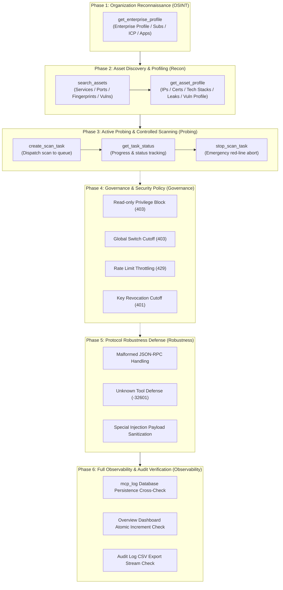

<div align="center">
  <p>
    <b>English</b> |
    <a href="./MCP_PENTEST_TEST_CASES.md"><b>简体中文</b></a>
  </p>
</div>

# ARL-Next MCP Penetration Testing Test Case Specification & Observability Framework

> This framework focuses on real-world red team penetration testing and offensive-defensive drills against the Model Context Protocol (MCP) Governance Center of ARL-Next, establishing a full-lifecycle test case matrix and an end-to-end observability cross-verification loop.<br>
> It covers 6 core stages with 23 dedicated test cases: OSINT Reconnaissance, Asset Fingerprinting, Controlled Active Probing, Security Governance & RBAC Defense, Protocol Robustness Defense, and Full-Audit Forensics.

---

## 1. Background & Pentest Mapping

In modern AI-augmented penetration testing workflows, security engineers utilize AI agents (such as Cursor, Windsurf, Claude Code, Claude Desktop, or Antigravity) to communicate with the ARL-Next asset platform via MCP. The interaction follows the standard red team penetration testing execution standard (PTES):



---

## 2. Observability Dimensions & Verification Matrix

The observability of the testing process spans across all architectural layers, validated via three cross-checking tiers:

| Observability Tier | Medium & Carrier | Verification Indicators & Checkpoints |
| :--- | :--- | :--- |
| **Real-time Client Observability** | Terminal ANSI / Rich Interactive Stream | - JSON-RPC 2.0 message ID, method, structured colored arguments<br>- Millisecond latency breakdown (`duration_ms`)<br>- SSE stream connection status and keepalive signals |
| **Server Persistence Observability** | MongoDB `mcp_log` Collection | - Verified entry writing (no lost events, no silent drops)<br>- Operator identity, credential prefix (`key_prefix`), real client IP<br>- Masked parameter summary length constraint (`params_summary` ≤ 200B)<br>- Strict status values (`success` / `error` / `denied`) |
| **Dashboard & Audit Governance** | REST `/api/mcp/overview` & CSV Export | - Atomic increment comparison of `today_calls`<br>- Incremental adjustment for top tools rank (`top_tools`)<br>- Streaming verification of `/api/mcp/logs/export` (CSV formula injection defense) |

---

## 3. Environment Prerequisites & Self-Healing Red Lines

1. **Credential Safety & Zero Dirt**:
   - Hardcoding production passwords, private keys, or system-level master tokens in test code is strictly prohibited.
   - All tests dynamically issue dedicated temporary testing keys with lifecycle bounds (e.g., `arl_mcp_test_*`).
   - On exit (normal completion, assertion failure, or `SIGINT/SIGTERM`), cleanup hooks revoke and physically delete temporary keys to maintain a clean database state.
2. **Safe Sandbox Execution Principle**:
   - In default mode, task scheduling cases (`create_scan_task`) must invoke `stop_scan_task` within seconds after confirming queueing and status, preventing computing waste or unintended traffic.
   - Only when `--live-fire` is explicitly supplied may tasks remain running to verify full scan asset aggregation.
3. **Status Terminology Alignment**:
   - Task states strictly adhere to project-wide standard enums: `running` (进行中), `waiting` (排队中), `done` (已完成), `stop` (已停止), `error` (异常失败). Plugin execution phases must be presented as `running · <plugin_name>`.

---

## 4. Pentest Case Matrix (23 Core Cases)

### Phase 1: OSINT & Enterprise Reconnaissance

#### Case TC-PENTEST-MCP-01: Enterprise Overview Profile
- **Objective**: Verify that the enterprise profile tool retrieves corporate background, ICP domains, and asset distributions in the initial recon stage.
- **Protocol Channel**: Remote SSE / Local Stdio
- **Test Payload**:
  ```json
  {
    "jsonrpc": "2.0",
    "id": 101,
    "method": "tools/call",
    "params": {
      "name": "get_enterprise_profile",
      "arguments": {
        "target": "example.com",
        "category": "all"
      }
    }
  }
  ```
- **Expected Result**:
  - HTTP status `200` (SSE response frame)
  - `result.isError`: `false`
  - Returned JSON contains `enterprise_name`, `categories` summary counts, and `status: "ok"`
- **Observability Checkpoints**:
  - Client: Measure execution latency and verify parsing completeness.
  - Server: New entry inserted in `mcp_log` with `tool_name: "get_enterprise_profile"`, `status: "success"`, `target: "example.com"`.

#### Case TC-PENTEST-MCP-02: Web Domains & Exposed Sites Drill-down
- **Objective**: Verify targeted pagination and drill-down into ICP registered web assets.
- **Protocol Channel**: Remote SSE / Local Stdio
- **Test Payload**:
  ```json
  {
    "jsonrpc": "2.0",
    "id": 102,
    "method": "tools/call",
    "params": {
      "name": "get_enterprise_profile",
      "arguments": {
        "target": "example.com",
        "category": "web",
        "page": 1,
        "size": 10
      }
    }
  }
  ```
- **Expected Result**:
  - `result.isError`: `false`
  - Returns `items` list (site domains, titles, ICP numbers) matching `page` and `size`.
- **Observability Checkpoints**:
  - Server audit: `mcp_log` contains `category: "web"` in `params_summary`, duration recorded normally.

#### Case TC-PENTEST-MCP-03: Mobile & Social Ecosystem Discovery (APP / Mini-Programs / WeChat)
- **Objective**: Verify asset discovery across mobile apps, WeChat mini-programs, and official accounts.
- **Test Payload**: Sequential invocations with `category="app"`, `category="mapp"`, `category="wechat"`.
- **Expected Result**:
  - Returns corresponding mobile digital assets with package names, titles, or entity tags.
- **Observability Checkpoints**:
  - Each dimension generates an independent audit event with corresponding category labels.

#### Case TC-PENTEST-MCP-04: Investment & Subsidiary Penetration
- **Objective**: Verify subsidiary discovery using `category="invest"` to expand pentest target scopes.
- **Test Payload**:
  ```json
  {
    "jsonrpc": "2.0",
    "id": 104,
    "method": "tools/call",
    "params": {
      "name": "get_enterprise_profile",
      "arguments": {
        "target": "example.com",
        "category": "invest",
        "size": 20
      }
    }
  }
  ```
- **Expected Result**:
  - Returns investment entity records, ownership percentages, or legal entities.
- **Observability Checkpoints**:
  - Logged in `mcp_log` with duration typically between 20ms and 300ms.

---

### Phase 2: Asset Discovery & Fingerprinting

#### Case TC-PENTEST-MCP-05: Asset Multi-dimensional Search (Fingerprints & Services)
- **Objective**: Verify keyword querying across components, ports, or fingerprints in existing assets.
- **Test Payload**:
  ```json
  {
    "jsonrpc": "2.0",
    "id": 201,
    "method": "tools/call",
    "params": {
      "name": "search_assets",
      "arguments": {
        "query": "nginx",
        "asset_type": "site",
        "limit": 10
      }
    }
  }
  ```
- **Expected Result**:
  - `result.isError`: `false`
  - Returns `type: "site"` with site URLs, titles, and fingerprints; length bounded by `limit`.
- **Observability Checkpoints**:
  - `mcp_log` summary records `命中 X 条记录` (Matched X records).

#### Case TC-PENTEST-MCP-06: Known Vulnerability Correlation Search
- **Objective**: Verify search against high-severity known vulnerabilities previously recorded.
- **Test Payload**:
  ```json
  {
    "jsonrpc": "2.0",
    "id": 202,
    "method": "tools/call",
    "params": {
      "name": "search_assets",
      "arguments": {
        "query": "cve",
        "asset_type": "vuln",
        "limit": 5
      }
    }
  }
  ```
- **Expected Result**:
  - Returns vulnerability records with vuln names, severity levels, and target mappings.
- **Observability Checkpoints**:
  - Server logs `tool_name: "search_assets"` with the search term.

#### Case TC-PENTEST-MCP-07: Comprehensive Target Host Profile
- **Objective**: Verify multi-source aggregation for a specific domain/IP (DNS IPs, open ports, SSL certs, web tech, vulns, and leak intel).
- **Test Payload**:
  ```json
  {
    "jsonrpc": "2.0",
    "id": 203,
    "method": "tools/call",
    "params": {
      "name": "get_asset_profile",
      "arguments": {
        "target": "example.com"
      }
    }
  }
  ```
- **Expected Result**:
  - `result.isError`: `false`
  - Returns aggregated profile dictionary across `site`, `ip`, `port`, `service`, `vuln`, and `cert`.
- **Observability Checkpoints**:
  - Client displays metric badges. Server records audit log with `status: "success"`.

#### Case TC-PENTEST-MCP-08: Task Context Locked Profile Drill-down
- **Objective**: Verify that supplying a 24-char `task_id` locks the asset profile to that specific scan's historical snapshot.
- **Test Payload**:
  ```json
  {
    "jsonrpc": "2.0",
    "id": 204,
    "method": "tools/call",
    "params": {
      "name": "get_asset_profile",
      "arguments": {
        "target": "example.com",
        "task_id": "671000000000000000000001"
      }
    }
  }
  ```
- **Expected Result**:
  - Returns data scoped to the specified task context.
- **Observability Checkpoints**:
  - Verify `task_id` traceability in `params_summary` in audit logs.

---

### Phase 3: Active Probing & Task Management

#### Case TC-PENTEST-MCP-09: Controlled Scan Task Submission
- **Objective**: Verify scanning task creation when the key has `task:dispatch` and tool switch is active.
- **Test Payload**:
  ```json
  {
    "jsonrpc": "2.0",
    "id": 301,
    "method": "tools/call",
    "params": {
      "name": "create_scan_task",
      "arguments": {
        "name": "pentest_mcp_probe_test",
        "target": "192.0.2.1"
      }
    }
  }
  ```
- **Expected Result**:
  - `result.isError`: `false`
  - Returns `status: "success"`, 24-character `task_id`, and `task_ids` list.
- **Observability Checkpoints**:
  - Client extracts `task_id`. Server records audit with summary `新任务 ID: <task_id>`.

#### Case TC-PENTEST-MCP-10: Task Progress Tracking & Status Verification
- **Objective**: Verify task status inspection and standard lifecycle enum compliance.
- **Test Payload**:
  ```json
  {
    "jsonrpc": "2.0",
    "id": 302,
    "method": "tools/call",
    "params": {
      "name": "get_task_status",
      "arguments": {
        "task_id": "<task_id>"
      }
    }
  }
  ```
- **Expected Result**:
  - `result.isError`: `false`
  - Returns `status` (strictly `waiting`, `running`, `done`, or `stop`), `start_time`, and `progress`.
- **Observability Checkpoints**:
  - Assert that task state string complies with unified project vocabulary.

#### Case TC-PENTEST-MCP-11: Red-Line Emergency Scan Abort
- **Objective**: Simulate emergency disengagement when hitting production boundaries, verifying Celery revocation via `stop_scan_task`.
- **Test Payload**:
  ```json
  {
    "jsonrpc": "2.0",
    "id": 303,
    "method": "tools/call",
    "params": {
      "name": "stop_scan_task",
      "arguments": {
        "task_id": "<task_id>"
      }
    }
  }
  ```
- **Expected Result**:
  - `result.isError`: `false`
  - Subsequent `get_task_status` reveals status transitioning to `stop` (已停止).
- **Observability Checkpoints**:
  - Audit log records summary `已请求停止任务: <task_id>`.

#### Case TC-PENTEST-MCP-12: Scan Parameter Boundary Defense (Empty Target)
- **Objective**: Verify parameter validation defense when target is missing or malformed.
- **Test Payload**: `arguments: {"name": "test", "target": ""}`
- **Expected Result**:
  - `result.isError`: `true`
  - Error message: `Both name and target are required`
- **Observability Checkpoints**:
  - Recorded as `status: "error"`, leaving zero orphaned Celery tasks.

---

### Phase 4: Governance, RBAC & Policy Defense

#### Case TC-PENTEST-MCP-13: Read-Only Privilege Violation Interception
- **Objective**: Attempt calling `create_scan_task` using a key with only `asset:read` scope.
- **Expected Result**:
  - HTTP status `403 Forbidden`
  - Message: `Permission denied: key lacks 'task:dispatch' scope`
- **Observability Checkpoints**:
  - Server records an audit entry with `status: "denied"`.

#### Case TC-PENTEST-MCP-14: Global Switch Cutoff Enforcement
- **Objective**: Turn off `tool_switches.create_scan_task` in system configuration; calling it must be blocked regardless of key scopes.
- **Expected Result**:
  - HTTP status `403 Forbidden`
  - Message: `Tool 'create_scan_task' is currently disabled in system settings`
- **Observability Checkpoints**:
  - Audit log captures `status: "denied"`.

#### Case TC-PENTEST-MCP-15: Rate Limit Throttling (HTTP 429)
- **Objective**: Verify throttling when request rate exceeds `rate_limit_per_min`.
- **Expected Result**:
  - HTTP status `429 Too Many Requests`
  - Header: `Retry-After: <seconds>`
  - Message: `MCP per-key rate limit exceeded`
- **Observability Checkpoints**:
  - Anti-avalanche design: only the first breach per minute writes an audit record.

#### Case TC-PENTEST-MCP-16: Instant Key Revocation Cutoff
- **Objective**: Mark an active key as `revoked`; ongoing SSE session and subsequent calls must be immediately cut off.
- **Expected Result**:
  - Subsequent calls return `HTTP 401 Unauthorized`.
- **Observability Checkpoints**:
  - Immediate zero-latency credential revocation verification.

#### Case TC-PENTEST-MCP-17: Expired Credential Denial
- **Objective**: Verify that credentials with past `expire_at` timestamps cannot initiate requests.
- **Expected Result**:
  - Returns `HTTP 401 Unauthorized`.

---

### Phase 5: Protocol Robustness & Fuzzing Defense

#### Case TC-PENTEST-MCP-18: Malformed JSON-RPC Resilience
- **Objective**: Feed invalid JSON or payloads lacking `jsonrpc` version to upper message endpoints.
- **Expected Result**:
  - Returns standard JSON-RPC error codes `-32700` (Parse error) or `-32600` (Invalid Request) without daemon crashes.
- **Observability Checkpoints**:
  - Client receives standard error frame; no unhandled server-side exceptions.

#### Case TC-PENTEST-MCP-19: Unknown Tool Defense
- **Objective**: Invoke a non-existent tool name (e.g., `exploit_target`).
- **Expected Result**:
  - Returns standard error `-32601` or `404 Not Found`.
- **Observability Checkpoints**:
  - Recorded as blocked audit entry.

#### Case TC-PENTEST-MCP-20: Large Payloads & Special Injection Sanitization
- **Objective**: Send SQL injection strings, XSS payloads, and excessive lengths in `target`.
- **Expected Result**:
  - Normal sanitization and regex handling, causing zero database injection or UI issues.
- **Observability Checkpoints**:
  - `params_summary` truncated cleanly in `mcp_log`.

---

### Phase 6: Full Observability & Audit Verification

#### Case TC-PENTEST-MCP-21: MongoDB `mcp_log` Persistence Cross-Check
- **Objective**: Verify every tool call has a corresponding row in `mcp_log` without omissions.
- **Verification Logic**:
  - Query `/api/mcp/logs?key_id=<test_key_id>`.
  - Assert existence and accuracy of `tool_name`, `target`, `duration_ms` (>0), and `client_ip`.
- **Expected Result**:
  - Audit count exactly matches executed audited calls.

#### Case TC-PENTEST-MCP-22: Overview Dashboard Atomic Increment Check
- **Objective**: Verify atomic consistency in `/api/mcp/overview` before and after test runs.
- **Verification Logic**:
  - Record `baseline_today_calls` before tests.
  - Record `final_today_calls` after tests.
  - Assert that `delta = final - baseline` matches total audited calls.
- **Expected Result**:
  - Strict 1:1 parity between dashboard counters and executed requests.

#### Case TC-PENTEST-MCP-23: Audit Log CSV Export Stream Check
- **Objective**: Validate `/api/mcp/logs/export` against CSV formula injection (`=`, `+`, `-`, `@`).
- **Expected Result**:
  - Response header: `Content-Type: text/csv`.
  - Escaped formula characters.

---

## 5. Automated Test Suite Execution Guide

The test suite is executable via `tools/verify_mcp_pentest.py`.

### 5.1 CLI Execution Examples

```bash
# 1. Quick run (Remote SSE mode against safe default target, auto cleanup)
python3 tools/verify_mcp_pentest.py

# 2. Specify pentest target domain
python3 tools/verify_mcp_pentest.py --target example.com --channel sse

# 3. Dual-channel verification (Remote SSE + Local Stdio)
python3 tools/verify_mcp_pentest.py --channel all

# 4. Custom host and administrator credentials
python3 tools/verify_mcp_pentest.py \
    --host https://<ARL_HOST>:5173 \
    --token <ADMIN_TOKEN> \
    --target example.com

# 5. Live fire mode (Authorized targets only, keeps scan tasks running)
python3 tools/verify_mcp_pentest.py --target authorized-target.corp --live-fire
```

### 5.2 Command Line Options

| Argument | Default | Description |
| :--- | :--- | :--- |
| `--host` | `ARL_HOST` / `ARL_auth.md` | Target ARL-Next base URL |
| `--token` | `ARL_TOKEN` / `ARL_auth.md` | Admin Token for issuing and cleaning test keys |
| `--basic-auth`| `ARL_BASIC_AUTH` | Gateway HTTP Basic Auth (`user:pass`) |
| `--target` | `example.com` | Primary reconnaissance and pentest target |
| `--channel` | `sse` | Transport channel: `sse`, `stdio`, or `all` |
| `--live-fire` | `False` | Run full scans without instant emergency termination |
| `--report-dir`| `./artifacts/mcp_reports` | Directory where Markdown and HTML reports are written |

### 5.3 Generated Artifacts

Upon completion, two structured reports will be written into `--report-dir`:
- `mcp_pentest_report.md`: Markdown report with summary badges, Mermaid sequence timeline, latency breakdown, and audit proof.
- `mcp_pentest_report.html`: Visual HTML dashboard with interactive foldable JSON frames and colored trace lines.
