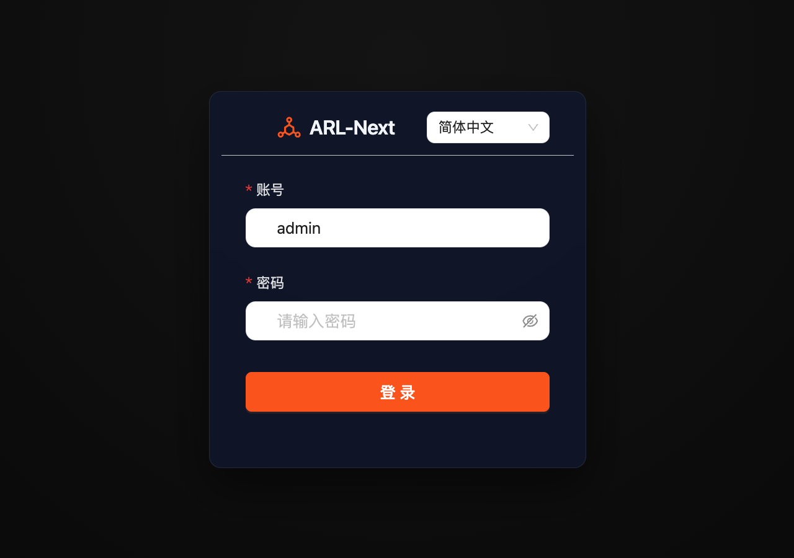

# ARL-Next Quickstart (5-Minute Baseline)

> Goal: complete the minimal loop "log in → create group → launch first task → review results" in 5 minutes.
> This page keeps only the minimal path; details live in `README_en.md`, `docs/API_GUIDE_en.md`, and `CHANGELOG_en.md`.

---

## What changed in this release (v1.4.3)

- **Full-system data backup & restore**: "System Settings → Backup and restore" and the host CLI `python3 tools/arl_backup.py` support one-click full database & environment snapshot export/restore, guarded by a full-stack maintenance lock and automatic rollback on failure.
- **Trilingual UI & MCP Governance Center**: switch between 简体中文 / English / Русский from the top navigation bar; the new sidebar "MCP Center" manages fine-grained scoped keys, tool-level permission switches, rate quotas, and invocation audit logs.
- **WIH API endpoint probing & group workflow**: site details now extract static API endpoint candidates from JS assets and probe same-origin reachability; "New Asset Group" supports automated enterprise panorama recon filing and task-to-group linking.
- Full changes: [`CHANGELOG_en.md`](../CHANGELOG_en.md).

---

## Prerequisites

- A reachable server with TCP port **5173** open (security group and host firewall).
- Root access on the server; **4-core CPU, 4GB RAM or higher** recommended; the script installs Docker and Swap automatically.

---

## Step 1: Deploy and log in (~1 min)

On the server (fast path via regional mirror):

```bash
mkdir -p ~/ARL-Next && cd ~/ARL-Next && \
docker pull crpi-laul1izptqrf0tkf.cn-beijing.personal.cr.aliyuncs.com/owl234-arl-prod/arl-web:latest && \
docker rm -f arl-temp 2>/dev/null || true && \
docker create --name arl-temp crpi-laul1izptqrf0tkf.cn-beijing.personal.cr.aliyuncs.com/owl234-arl-prod/arl-web:latest && \
docker cp arl-temp:/code/start-prod.sh ./ && \
docker cp arl-temp:/code/docker-compose.prod.yml ./ && \
docker cp arl-temp:/code/updater ./ && \
docker cp arl-temp:/code/tools ./ && \
docker cp arl-temp:/code/version.txt ./ && \
docker cp arl-temp:/code/CHANGELOG.md ./ && \
docker cp arl-temp:/code/CHANGELOG_en.md ./ && \
mkdir -p ./frontend && docker cp arl-temp:/code/frontend/default.conf.prod ./frontend/ && \
docker rm -f arl-temp && \
chmod +x start-prod.sh && bash start-prod.sh
```

> [!TIP]
> - **Single-line Execution Tip**: Some cloud web terminals (such as Web SSH or VNC) may drop newlines when pasting multiple lines at once, causing errors such as `No such container: arl-temp`. If you encounter this, expand the "Step-by-Step Single-Line Commands" below and paste each line individually.

<details>
<summary><b>🛠️ If multi-line paste errors occur, click to expand [Step-by-Step Single-Line Commands]</b></summary>
<br/>

```bash
# 1. Create and enter directory
mkdir -p ~/ARL-Next && cd ~/ARL-Next

# 2. Pull the latest production image
docker pull crpi-laul1izptqrf0tkf.cn-beijing.personal.cr.aliyuncs.com/owl234-arl-prod/arl-web:latest

# 3. Extract orchestration scripts
docker rm -f arl-temp 2>/dev/null || true
docker create --name arl-temp crpi-laul1izptqrf0tkf.cn-beijing.personal.cr.aliyuncs.com/owl234-arl-prod/arl-web:latest
docker cp arl-temp:/code/start-prod.sh ./
docker cp arl-temp:/code/docker-compose.prod.yml ./
docker cp arl-temp:/code/updater ./
docker cp arl-temp:/code/tools ./
docker cp arl-temp:/code/version.txt ./
docker cp arl-temp:/code/CHANGELOG.md ./
docker cp arl-temp:/code/CHANGELOG_en.md ./
mkdir -p ./frontend && docker cp arl-temp:/code/frontend/default.conf.prod ./frontend/
docker rm -f arl-temp

# 4. Start the stack
chmod +x start-prod.sh && bash start-prod.sh
```

</details>

Then open `https://<your-server-ip>:5173` (accept the self-signed certificate warning on first visit).

<p align="center"></p>

| Layer | Default user | Default password | Notes |
| :--- | :--- | :--- | :--- |
| ARL-Next login | `admin` | Randomly generated on first startup | Read it on a trusted host using the command below; existing passwords are preserved |

```bash
docker exec arl-web-prod cat /tmp/arl_initial_admin_password
```

Alternatively, set `ARL_ADMIN_PASSWORD` (at least 12 characters) before first startup; no password file is generated in that case (note that `sudo` strips environment variables by default, so pass it via `sudo ARL_ADMIN_PASSWORD=... bash start-prod.sh`, `sudo -E bash start-prod.sh`, or `.env` in the deployment directory). The initial password is not logged. Remove the file after changing the password and confirming login (`docker exec arl-web-prod rm -f /tmp/arl_initial_admin_password`); if the container is recreated before reading it, reset via `--reset` in `README_en.md` FAQ Q2. Login sessions expire after 24 hours.

> Notes: the Nginx Basic Auth front gate is off by default; toggle it in the top navigation bar if needed.

---

## Step 2: Create a group (~1 min)

> **New users: pick "Manual asset entry"**: zero credentials, zero waiting — the group is usable immediately.
> "Enterprise panorama recon → group" is the advanced path — Tianyancha GID pivoting needs a commercial credential (a dialog guides you to configure it), and recon runs as an async backend job.

Open "Asset Group" in the sidebar → "New Asset Group" → pick "✍️ Manual asset entry":

<p align="center"></p>

Fill "Scope" directly; mixed IP, CIDR, and domains are accepted (e.g. `1.1.1.1, baidu.com, 192.168.1.0/24`), separated by commas or newlines.

<p align="center"></p>

<details>
<summary><b>Advanced: enterprise panorama recon → group (needs Tianyancha credential / async wait)</b></summary>
<br/>

Pick "🏢 Enterprise panorama recon → group" and paste a Tianyancha link (e.g. `company/25174642`), GID, or the registered company name into "Enterprise target":

<p align="center"></p>

- **GID / Tianyancha link**: configure the commercial Tianyancha credential first under "System Settings → Asset recon & intel", otherwise a dialog prompts you to configure it.
- **Registered company name**: goes through the official MIIT ICP filing lookup with no commercial credential; the backend auto-upgrades to dual-track panorama recon when it matches a Tianyancha entity.
- Leave "Group name" empty to auto-name it from the official company name; keep auto-filing enabled, then the backend files the group without keeping the page open.

</details>

---

## Step 3: Launch the first task (~1 min)

> **New users: pick the "Fast recon" preset**: shortest run to close the loop first; try standard/deep when needed.

Open "Task Management" → click "Asset Recon Tasks" to switch views → "New recon task" (dialog title "New asset recon task"):

<p align="center"></p>

1. "Task name": give it a recognizable name.
2. "Related asset group (optional)": pick the group when ready; results sync to it on completion, and every target must fall inside that group's scope.
3. "Target": enter a domain (`example.com`), IP (`1.1.1.1`), or subnet (`192.168.1.0/24`); one target per line for multiples.
4. Click the "Fast recon" preset directly.
5. Click submit ("Submit Task").

<p align="center"></p>

<details>
<summary><b>Advanced: standard probe vs deep full</b></summary>
<br/>

- "Standard probe": adds service detection, SSL certificate fetch, and file-leak checks on top of fast recon; broader coverage, medium run time.
- "Deep full": enables all plugins and turns off "skip CDN" (CDN node IPs get scanned too); widest coverage with highest time and resource cost, with a confirm step.

> Notes: each domain fans out to its own task, while IP / CIDR targets merge into one task; the dialog previews the fan-out count.

</details>

---

## Step 4: Review results (~2 min)

<p align="center"></p>

- In "Task Management", filter by status: `running` (In progress), `waiting` (Queued), `done` (Completed), `stop` (Stopped), `error` (Failed); running phases render as "In progress · \<phase\>" (e.g. port scan).
- Open the task detail for domains, sites, services, and vulnerability breakdowns; tasks linked to a group expose the group tag for jump-through.
- Use the profile drawer in "Asset Search" or the group detail to drill into site, certificate, leak, and vulnerability dimensions.

---

## Step 5: Next steps

- For recurring runs: open "Planning & Scheduling", which separates one-shot plans from continuous monitoring.
- For concurrency: open "System Settings → Scan & Concurrency → Task queue concurrency"; the three values are Worker process counts. Per-task blasting concurrency lives under "Advanced scan & environment" — they are different magnitudes.
- For automation: open `https://<your-server-ip>:5173/api/doc` with `docs/API_GUIDE_en.md`; for AI agents see `mcp-server/README_en.md`.

---

## Upgrade notes

- Prefer idle windows: triggering an update from "System Settings → System version & update" (button labeled "One-Click System Update") restarts background Workers and interrupts running scan tasks.
- Data compatibility: upgrades run incremental migrations and backfill missing fields without overwriting saved config; persistent volume names stay unchanged.

---

## Quick troubleshooting

- Certificate warning in the browser: expected for the self-signed certificate; proceed as prompted, or replace it with a commercial certificate per `README_en.md`.
- Forgot the password: see FAQ Q2 in `README_en.md` (platform password and Basic Auth are handled separately).
- Update reports a trigger failure: see FAQ Q3 in `README_en.md` (manual terminal upgrade or restart `arl-updater.service`).

---

## Related links

- [Deploy & Ops (README)](../README_en.md) · [API conventions](API_GUIDE_en.md) · [MCP setup](../mcp-server/README_en.md) · [Changelog](../CHANGELOG_en.md)
